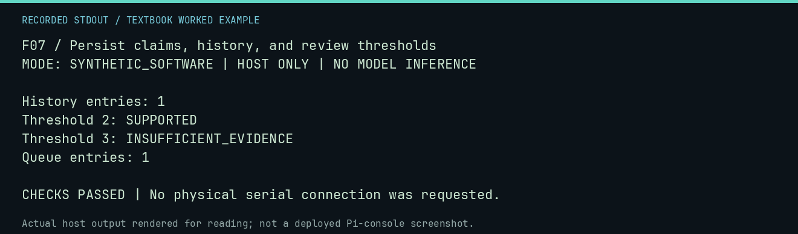

# F07 worked lab: Persist claims, history, and review thresholds

**Goal:** Persist claims, history, and review thresholds.

**Mode:** `SYNTHETIC_SOFTWARE`. This companion runs on the host; it does not
change the original packet's paper activity or authorize physical Replica work.

## Understand the example

META stores statements and evidence relationships. A tribunal verdict depends on declared rules and evidence level, not the confidence of a model explanation. This synthetic claim is a database exercise, not a new scientific result.

## Predict before running

Read the source below. Write down the expected printed values and the condition
that would make its checks fail. For a CPU trace, distinguish state before an
instruction from state after it. For a conceptual exercise, explain the rule
behind each classification rather than memorizing the printed label.

## Run it

From the checkout root with your environment active:

```bash
python -m tools.textbook run F07
```

The runner executes this [complete source](../examples/F07.py):

```python
from pathlib import Path
from tempfile import TemporaryDirectory

from neural1.meta import ClaimGraph
from neural1.meta_store import ResearchDatabase

graph = ClaimGraph()
claim = graph.create_claim("FIXTURE X SUPPORTS Y", {"experiment": "textbook fixture"})
evidence = graph.add_evidence("synthetic", "a" * 64, ["FIXTURE"], "authored test evidence", causal_level=2)
with TemporaryDirectory() as d:
    db = ResearchDatabase(Path(d) / "meta.sqlite")
    try:
        db.put_claim(claim)
        db.put_evidence(evidence)
        db.relate(evidence.evidence_id, "supports", claim.claim_id)
        print("History entries:", len(db.claim_history(claim.claim_id)))
        print("Threshold 2:", db.tribunal(claim.claim_id, minimum_causal_level=2)["verdict"])
        print("Threshold 3:", db.tribunal(claim.claim_id, minimum_causal_level=3)["verdict"])
        db.enqueue(
            "Repeat the controlled test",
            uncertainty=1,
            novelty=0,
            information_gain=1,
            cross_experiment_relevance=0,
            normalized_compute_cost=1,
        )
        print("Queue entries:", len(db.research_queue()))
        assert len(db.claim_history(claim.claim_id)) == 1
    finally:
        db.close()
```

## Recorded result

This output was actually executed and checked. The image is a readable render
of that stdout, not a screenshot of the deployed Pi console. A teaching fixture
or a host analogue is not independent historical or physical evidence.

```text
F07 / Persist claims, history, and review thresholds
MODE: SYNTHETIC_SOFTWARE | HOST ONLY | NO MODEL INFERENCE

History entries: 1
Threshold 2: SUPPORTED
Threshold 3: INSUFFICIENT_EVIDENCE
Queue entries: 1

CHECKS PASSED | No physical serial connection was requested.
```



[Raw output](../captures/F07.txt) · [Capture manifest](../captures/manifest.json)

## Change one thing

Would an authored causal_level=2 make this fixture a causal discovery?

<details>
<summary>Compare your reasoning with the worked answer</summary>

No. It exercises the rules; the evidence itself is explicitly synthetic.

</details>

## Check your understanding

Explain the result without reading the code aloud. Name one condition that the
example did not test. Keep your prediction, changed input, actual output, and
interpretation together in your lab notebook. Use the linked textbook chapter
and the original source records for the broader context and evidence limits.

[Textbook home](../README.md) · Previous: [F06: Verify an export and detect changed evidence](F06.md) · Next: [F08: Evaluate 4k-mind with explicit controls](F08.md)
