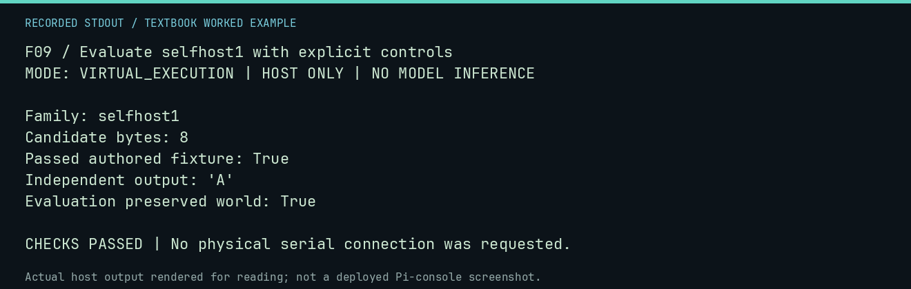

# F09 worked lab: Evaluate selfhost1 with explicit controls

**Goal:** Evaluate selfhost1 with explicit controls.

**Mode:** `VIRTUAL_EXECUTION`. This companion runs on the host; it does not
change the original packet's paper activity or authorize physical Replica work.

## Understand the example

A successful raw-code task is stage-one evidence. It is not the discovery of an assembler or compiler. This fixture supplies a known routine and checks the implemented family criterion.

## Predict before running

Read the source below. Write down the expected printed values and the condition
that would make its checks fail. For a CPU trace, distinguish state before an
instruction from state after it. For a conceptual exercise, explain the rule
behind each classification rather than memorizing the printed label.

## Run it

From the checkout root with your environment active:

```bash
python -m tools.textbook run F09
```

The runner executes this [complete source](../examples/F09.py):

```python
from neural1.family_runner import evaluate_family
from neural1.world import VirtualApple1World, WozMonSession

world = VirtualApple1World()
records = []
image = bytes.fromhex("A9 41 20 EF FF 4C 1F FF") + bytes(0)
for generation in range(2):
    for agent in range(1):
        commands = [f"{0x200 + i:04X}: " + image[i : i + 16].hex(" ").upper() for i in range(0, len(image), 16)] + ["0200R"]
        records.append(
            {
                "generation": generation,
                "agent_id": str(agent),
                "response": "\n".join(commands),
                "outputs": [WozMonSession(world).transact(c) for c in commands],
            }
        )
world.generation = 2
before = world.snapshot()
result = evaluate_family("selfhost1", world, records)
print("Family:", result["family"])
print("Candidate bytes:", len(image))
print("Passed authored fixture:", result["passed"])
print("Independent output:", repr(result["independent_execution"]["screen_text"]))
print("Evaluation preserved world:", world.snapshot() == before)
assert result["passed"] and result["independent_execution"]["screen_text"] == "A"
assert world.snapshot() == before
```

## Recorded result

This output was actually executed and checked. The image is a readable render
of that stdout, not a screenshot of the deployed Pi console. A teaching fixture
or a host analogue is not independent historical or physical evidence.

```text
F09 / Evaluate selfhost1 with explicit controls
MODE: VIRTUAL_EXECUTION | HOST ONLY | NO MODEL INFERENCE

Family: selfhost1
Candidate bytes: 8
Passed authored fixture: True
Independent output: 'A'
Evaluation preserved world: True

CHECKS PASSED | No physical serial connection was requested.
```



[Raw output](../captures/F09.txt) · [Capture manifest](../captures/manifest.json)

## Change one thing

What negative control would prevent an always-pass evaluator from appearing correct?

<details>
<summary>Compare your reasoning with the worked answer</summary>

Use an empty/incorrect program or a structurally invalid candidate and require rejection. A positive fixture alone is insufficient.

</details>

## Check your understanding

Explain the result without reading the code aloud. Name one condition that the
example did not test. Keep your prediction, changed input, actual output, and
interpretation together in your lab notebook. Use the linked textbook chapter
and the original source records for the broader context and evidence limits.

[Textbook home](../README.md) · Previous: [F08: Evaluate 4k-mind with explicit controls](F08.md) · Next: [F10: Evaluate 256-byte-universe with explicit controls](F10.md)
