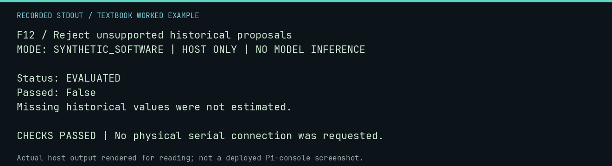

# F12 worked lab: Reject unsupported historical proposals

**Goal:** Reject unsupported historical proposals.

**Mode:** `SYNTHETIC_SOFTWARE`. This companion runs on the host; it does not
change the original packet's paper activity or authorize physical Replica work.

## Understand the example

Historical validation cannot manufacture missing components or prices. This negative example asks the actual family evaluator to inspect an empty proposal set. It should evaluate the input while declining to call it a valid design.

## Predict before running

Read the source below. Write down the expected printed values and the condition
that would make its checks fail. For a CPU trace, distinguish state before an
instruction from state after it. For a conceptual exercise, explain the rule
behind each classification rather than memorizing the printed label.

## Run it

From the checkout root with your environment active:

```bash
python -m tools.textbook run F12
```

The runner executes this [complete source](../examples/F12.py):

```python
from neural1.family_runner import evaluate_family
from neural1.world import VirtualApple1World

result = evaluate_family("1976-multiverse", VirtualApple1World(), [])
print("Status:", result["status"])
print("Passed:", result["passed"])
assert result["status"] == "EVALUATED" and not result["passed"]
print("Missing historical values were not estimated.")
```

## Recorded result

This output was actually executed and checked. The image is a readable render
of that stdout, not a screenshot of the deployed Pi console. A teaching fixture
or a host analogue is not independent historical or physical evidence.

```text
F12 / Reject unsupported historical proposals
MODE: SYNTHETIC_SOFTWARE | HOST ONLY | NO MODEL INFERENCE

Status: EVALUATED
Passed: False
Missing historical values were not estimated.

CHECKS PASSED | No physical serial connection was requested.
```



[Raw output](../captures/F12.txt) · [Capture manifest](../captures/manifest.json)

## Change one thing

Does the reviewed year-end corpus promote the broad March-1976 staging index?

<details>
<summary>Compare your reasoning with the worked answer</summary>

No. The two datasets have different source and cutoff scopes.

</details>

## Check your understanding

Explain the result without reading the code aloud. Name one condition that the
example did not test. Keep your prediction, changed input, actual output, and
interpretation together in your lab notebook. Use the linked textbook chapter
and the original source records for the broader context and evidence limits.

[Textbook home](../README.md) · Previous: [F11: Evaluate ram-republic with explicit controls](F11.md) · Next: [F13: Ground Field Library operations in a real lesson corpus](F13.md)
