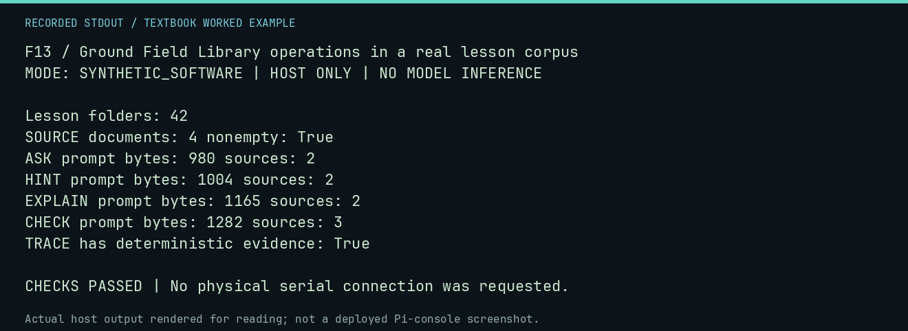

# F13 worked lab: Ground Field Library operations in a real lesson corpus

**Goal:** Ground Field Library operations in a real lesson corpus.

**Mode:** `SYNTHETIC_SOFTWARE`. This companion runs on the host; it does not
change the original packet's paper activity or authorize physical Replica work.

## Understand the example

SOURCE reads the selected lesson documents without inference. ASK/HINT/EXPLAIN/CHECK assemble bounded, source-grounded prompts; TRACE first executes a deterministic program. A fixed provider here exposes that plumbing without claiming model understanding.

## Predict before running

Read the source below. Write down the expected printed values and the condition
that would make its checks fail. For a CPU trace, distinguish state before an
instruction from state after it. For a conceptual exercise, explain the rule
behind each classification rather than memorizing the printed label.

## Run it

From the checkout root with your environment active:

```bash
python -m tools.textbook run F13
```

The runner executes this [complete source](../examples/F13.py):

```python
from neural1.field_library import FieldLibraryAssistant, LessonCorpus
from neural1.models import FakeProvider
from tools.textbook_support import ROOT

corpus = LessonCorpus(ROOT / "docs/field-library")
text, paths = corpus.context("M03")
print("Lesson folders:", len(corpus.lessons()))
print("SOURCE documents:", len(paths), "nonempty:", bool(text))
assistant = FieldLibraryAssistant(corpus, FakeProvider(default="DETERMINISTIC EXPLANATION FROM RECORDED RESULT."))
for op in ("ASK", "HINT", "EXPLAIN", "CHECK"):
    result = assistant.answer(op, "M03", "What is the recorded screen output?")
    print(op, "prompt bytes:", result.prompt_bytes, "sources:", len(result.source_paths))
result = assistant.assemble_explain("A01", "LDA #$41\nJSR $FFEF\nJMP $FF1F")
print("TRACE has deterministic evidence:", result.deterministic_evidence is not None)
assert len(corpus.lessons()) == 42 and result.deterministic_evidence is not None
```

## Recorded result

This output was actually executed and checked. The image is a readable render
of that stdout, not a screenshot of the deployed Pi console. A teaching fixture
or a host analogue is not independent historical or physical evidence.

```text
F13 / Ground Field Library operations in a real lesson corpus
MODE: SYNTHETIC_SOFTWARE | HOST ONLY | NO MODEL INFERENCE

Lesson folders: 42
SOURCE documents: 4 nonempty: True
ASK prompt bytes: 980 sources: 2
HINT prompt bytes: 1004 sources: 2
EXPLAIN prompt bytes: 1165 sources: 2
CHECK prompt bytes: 1282 sources: 3
TRACE has deterministic evidence: True

CHECKS PASSED | No physical serial connection was requested.
```



[Raw output](../captures/F13.txt) · [Capture manifest](../captures/manifest.json)

## Change one thing

Does a source-grounded prompt guarantee that a real model answer is true?

<details>
<summary>Compare your reasoning with the worked answer</summary>

No. Inspect citations and deterministic evidence, test abstention, and keep model explanation separate from execution.

</details>

## Check your understanding

Explain the result without reading the code aloud. Name one condition that the
example did not test. Keep your prediction, changed input, actual output, and
interpretation together in your lab notebook. Use the linked textbook chapter
and the original source records for the broader context and evidence limits.

[Textbook home](../README.md) · Previous: [F12: Reject unsupported historical proposals](F12.md) · Next: [F14: Restore a snapshot and identify a one-factor fork](F14.md)
