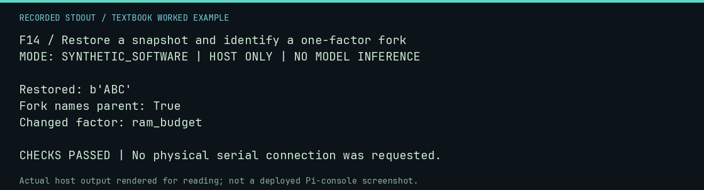

# F14 worked lab: Restore a snapshot and identify a one-factor fork

**Goal:** Restore a snapshot and identify a one-factor fork.

**Mode:** `SYNTHETIC_SOFTWARE`. This companion runs on the host; it does not
change the original packet's paper activity or authorize physical Replica work.

## Understand the example

A snapshot captures state; a manifest identifies scientific inputs. A fork names its parent and changed factor. Restoration is a host verifier operation, not a hidden memory tool given to the agent.

## Predict before running

Read the source below. Write down the expected printed values and the condition
that would make its checks fail. For a CPU trace, distinguish state before an
instruction from state after it. For a conceptual exercise, explain the rule
behind each classification rather than memorizing the printed label.

## Run it

From the checkout root with your environment active:

```bash
python -m tools.textbook run F14
```

The runner executes this [complete source](../examples/F14.py):

```python
from tempfile import TemporaryDirectory

from neural1.models import FakeProvider
from neural1.runtime import ExperimentRuntime, RunManifest
from neural1.world import VirtualApple1World

with TemporaryDirectory() as d:
    runtime = ExperimentRuntime(d)
    world = VirtualApple1World()
    world.host_write(0x300, b"ABC")
    snapshot = runtime.snapshot(world)
    world.host_write(0x300, b"XYZ")
    restored = runtime.restore(snapshot)
    base = RunManifest.create("4k-mind", 7, FakeProvider().record, {"ram_budget": 4096})
    fork = runtime.fork(base, fork_point="snapshot", changed_factor="ram_budget", config={"ram_budget": 1024})
    print("Restored:", repr(restored.host_read(0x300, 3)))
    print("Fork names parent:", fork.parent_run_id == base.run_id)
    print("Changed factor:", fork.changed_factor)
    assert restored.host_read(0x300, 3) == b"ABC" and fork.run_id != base.run_id
```

## Recorded result

This output was actually executed and checked. The image is a readable render
of that stdout, not a screenshot of the deployed Pi console. A teaching fixture
or a host analogue is not independent historical or physical evidence.

```text
F14 / Restore a snapshot and identify a one-factor fork
MODE: SYNTHETIC_SOFTWARE | HOST ONLY | NO MODEL INFERENCE

Restored: b'ABC'
Fork names parent: True
Changed factor: ram_budget

CHECKS PASSED | No physical serial connection was requested.
```



[Raw output](../captures/F14.txt) · [Capture manifest](../captures/manifest.json)

## Change one thing

Why preserve the same seed when changing one factor?

<details>
<summary>Compare your reasoning with the worked answer</summary>

It helps define a matched comparison, but does not eliminate every confound or guarantee identical model execution.

</details>

## Check your understanding

Explain the result without reading the code aloud. Name one condition that the
example did not test. Keep your prediction, changed input, actual output, and
interpretation together in your lab notebook. Use the linked textbook chapter
and the original source records for the broader context and evidence limits.

[Textbook home](../README.md) · Previous: [F13: Ground Field Library operations in a real lesson corpus](F13.md) · Next: [F15: Reset private context while retaining shared RAM](F15.md)
