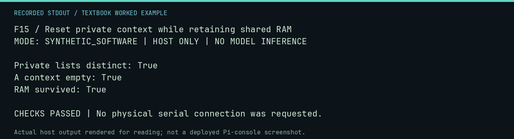

# F15 worked lab: Reset private context while retaining shared RAM

**Goal:** Reset private context while retaining shared RAM.

**Mode:** `SYNTHETIC_SOFTWARE`. This companion runs on the host; it does not
change the original packet's paper activity or authorize physical Replica work.

## Understand the example

The scheduler owns agent contexts, while the world owns memory. Resetting an agent conversation must not silently erase persistent RAM. Conversely, sharing model weights must not share private conversation lists.

## Predict before running

Read the source below. Write down the expected printed values and the condition
that would make its checks fail. For a CPU trace, distinguish state before an
instruction from state after it. For a conceptual exercise, explain the rule
behind each classification rather than memorizing the printed label.

## Run it

From the checkout root with your environment active:

```bash
python -m tools.textbook run F15
```

The runner executes this [complete source](../examples/F15.py):

```python
from neural1.models import FakeProvider
from neural1.scheduling import LogicalAgent, PopulationScheduler
from neural1.world import VirtualApple1World

world = VirtualApple1World()
agents = [LogicalAgent("A", "p"), LogicalAgent("B", "p")]
scheduler = PopulationScheduler(world, agents, {"p": FakeProvider(default="0300: 41")}, seed=7)
scheduler.round("DEPOSIT", lambda s: [s])
before = world.snapshot()
agents[0].reset_context()
print("Private lists distinct:", agents[0].private_context is not agents[1].private_context)
print("A context empty:", not agents[0].private_context)
print("RAM survived:", world.snapshot() == before)
assert not agents[0].private_context and world.snapshot() == before
```

## Recorded result

This output was actually executed and checked. The image is a readable render
of that stdout, not a screenshot of the deployed Pi console. A teaching fixture
or a host analogue is not independent historical or physical evidence.

```text
F15 / Reset private context while retaining shared RAM
MODE: SYNTHETIC_SOFTWARE | HOST ONLY | NO MODEL INFERENCE

Private lists distinct: True
A context empty: True
RAM survived: True

CHECKS PASSED | No physical serial connection was requested.
```



[Raw output](../captures/F15.txt) · [Capture manifest](../captures/manifest.json)

## Change one thing

Would persistence of an authored byte demonstrate a learned communication protocol?

<details>
<summary>Compare your reasoning with the worked answer</summary>

No. It demonstrates state behavior. A protocol claim needs operational criteria, controls, and replication.

</details>

## Check your understanding

Explain the result without reading the code aloud. Name one condition that the
example did not test. Keep your prediction, changed input, actual output, and
interpretation together in your lab notebook. Use the linked textbook chapter
and the original source records for the broader context and evidence limits.

[Textbook home](../README.md) · Previous: [F14: Restore a snapshot and identify a one-factor fork](F14.md) · Next: [F16: Inspect recorded native evidence without rerunning the Pi](F16.md)
