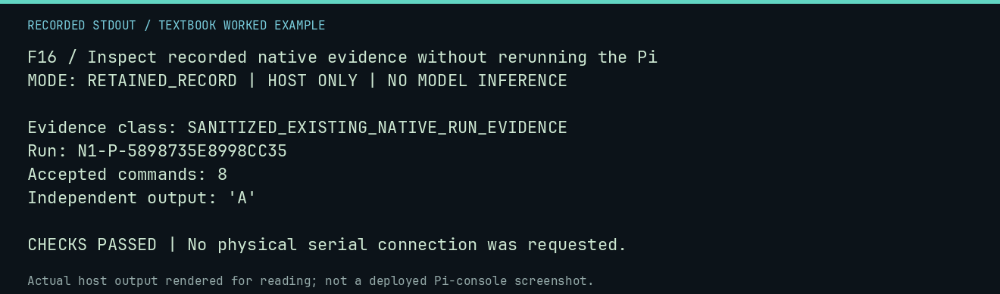

# F16 worked lab: Inspect recorded native evidence without rerunning the Pi

**Goal:** Inspect recorded native evidence without rerunning the Pi.

**Mode:** `RETAINED_RECORD`. This companion runs on the host; it does not
change the original packet's paper activity or authorize physical Replica work.

## Understand the example

This reads the published sanitized September closeout extract. It is a retained native observation, not fresh inference or a new hardware health check. The source record separates the model response, parser acceptance, and independent execution.

## Predict before running

Read the source below. Write down the expected printed values and the condition
that would make its checks fail. For a CPU trace, distinguish state before an
instruction from state after it. For a conceptual exercise, explain the rule
behind each classification rather than memorizing the printed label.

## Run it

From the checkout root with your environment active:

```bash
python -m tools.textbook run F16
```

The runner executes this [complete source](../examples/F16.py):

```python
import json

from tools.textbook_support import ROOT

p = ROOT / "docs/neural1/operations/evidence/pi-closeout-2026-09-10/post-boot-run.json"
r = json.loads(p.read_text())
print("Evidence class:", r["classification"])
print("Run:", r["campaign_id"])
print("Accepted commands:", r["family_result"]["accepted_transactions"])
print("Independent output:", repr(r["family_result"]["independent_execution"]["screen_text"]))
assert r["family_result"]["accepted_transactions"] == 8
assert r["family_result"]["independent_execution"]["screen_text"] == "A"
```

## Recorded result

This output was actually executed and checked. The image is a readable render
of that stdout, not a screenshot of the deployed Pi console. A teaching fixture
or a host analogue is not independent historical or physical evidence.

```text
F16 / Inspect recorded native evidence without rerunning the Pi
MODE: RETAINED_RECORD | HOST ONLY | NO MODEL INFERENCE

Evidence class: SANITIZED_EXISTING_NATIVE_RUN_EVIDENCE
Run: N1-P-5898735E8998CC35
Accepted commands: 8
Independent output: 'A'

CHECKS PASSED | No physical serial connection was requested.
```



[Raw output](../captures/F16.txt) · [Capture manifest](../captures/manifest.json)

## Change one thing

Can reading this file establish that the Pi is healthy now?

<details>
<summary>Compare your reasoning with the worked answer</summary>

No. It establishes what the retained record reports about that identified run.

</details>

## Check your understanding

Explain the result without reading the code aloud. Name one condition that the
example did not test. Keep your prediction, changed input, actual output, and
interpretation together in your lab notebook. Use the linked textbook chapter
and the original source records for the broader context and evidence limits.

[Textbook home](../README.md) · Previous: [F15: Reset private context while retaining shared RAM](F15.md) · Next: [F17: Inspect a synthetic disk image without touching a disk](F17.md)
