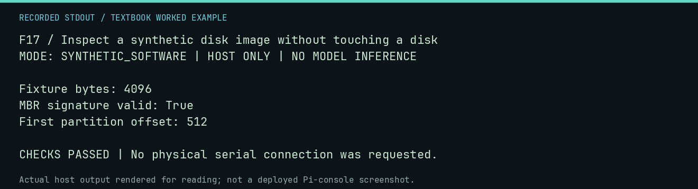

# F17 worked lab: Inspect a synthetic disk image without touching a disk

**Goal:** Inspect a synthetic disk image without touching a disk.

**Mode:** `SYNTHETIC_SOFTWARE`. This companion runs on the host; it does not
change the original packet's paper activity or authorize physical Replica work.

## Understand the example

The storage inspector accepts an ordinary image file. Here a tiny teaching image contains an MBR signature and one partition entry. It is not a bootable Pi image or a storage device.

## Predict before running

Read the source below. Write down the expected printed values and the condition
that would make its checks fail. For a CPU trace, distinguish state before an
instruction from state after it. For a conceptual exercise, explain the rule
behind each classification rather than memorizing the printed label.

## Run it

From the checkout root with your environment active:

```bash
python -m tools.textbook run F17
```

The runner executes this [complete source](../examples/F17.py):

```python
from pathlib import Path
from tempfile import TemporaryDirectory

from neural1.storage_commissioning import inspect_image

with TemporaryDirectory() as d:
    p = Path(d) / "fixture.img"
    data = bytearray(4096)
    data[510:512] = b"\x55\xaa"
    data[450] = 0x0C
    data[454:458] = (1).to_bytes(4, "little")
    data[458:462] = (4).to_bytes(4, "little")
    p.write_bytes(data)
    r = inspect_image(p, include_sha256=True)
    print("Fixture bytes:", r.size_bytes)
    print("MBR signature valid:", r.mbr_signature_valid)
    print("First partition offset:", r.partitions[0].byte_offset)
    assert r.mbr_signature_valid and r.partitions[0].byte_offset == 512
```

## Recorded result

This output was actually executed and checked. The image is a readable render
of that stdout, not a screenshot of the deployed Pi console. A teaching fixture
or a host analogue is not independent historical or physical evidence.

```text
F17 / Inspect a synthetic disk image without touching a disk
MODE: SYNTHETIC_SOFTWARE | HOST ONLY | NO MODEL INFERENCE

Fixture bytes: 4096
MBR signature valid: True
First partition offset: 512

CHECKS PASSED | No physical serial connection was requested.
```



[Raw output](../captures/F17.txt) · [Capture manifest](../captures/manifest.json)

## Change one thing

Would a valid MBR signature prove all files in the image are intact?

<details>
<summary>Compare your reasoning with the worked answer</summary>

No. It validates one structure, not the complete filesystem or historical provenance.

</details>

## Check your understanding

Explain the result without reading the code aloud. Name one condition that the
example did not test. Keep your prediction, changed input, actual output, and
interpretation together in your lab notebook. Use the linked textbook chapter
and the original source records for the broader context and evidence limits.

[Textbook home](../README.md) · Previous: [F16: Inspect recorded native evidence without rerunning the Pi](F16.md) · Next: [F18: Separate portal navigation from a physical launcher](F18.md)
