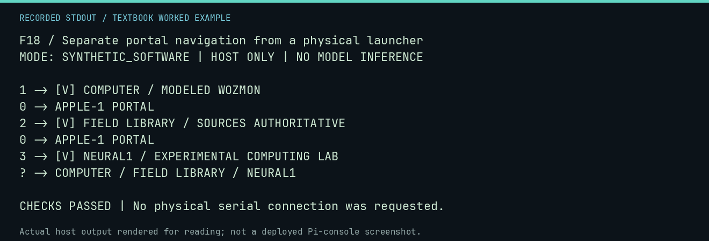

# F18 worked lab: Separate portal navigation from a physical launcher

**Goal:** Separate portal navigation from a physical launcher.

**Mode:** `SYNTHETIC_SOFTWARE`. This companion runs on the host; it does not
change the original packet's paper activity or authorize physical Replica work.

## Understand the example

The portal is a virtual state machine. Selecting COMPUTER changes its state and calls a virtual adapter. It neither opens a device nor resolves the physical launcher integration.

## Predict before running

Read the source below. Write down the expected printed values and the condition
that would make its checks fail. For a CPU trace, distinguish state before an
instruction from state after it. For a conceptual exercise, explain the rule
behind each classification rather than memorizing the printed label.

## Run it

From the checkout root with your environment active:

```bash
python -m tools.textbook run F18
```

The runner executes this [complete source](../examples/F18.py):

```python
from neural1.interface import Mode, Portal

portal = Portal()
for key in ("1", "0", "2", "0", "3", "?"):
    print(key, "->", portal.select(key))
assert portal.mode == Mode.ABOUT
```

## Recorded result

This output was actually executed and checked. The image is a readable render
of that stdout, not a screenshot of the deployed Pi console. A teaching fixture
or a host analogue is not independent historical or physical evidence.

```text
F18 / Separate portal navigation from a physical launcher
MODE: SYNTHETIC_SOFTWARE | HOST ONLY | NO MODEL INFERENCE

1 -> [V] COMPUTER / MODELED WOZMON
0 -> APPLE-1 PORTAL
2 -> [V] FIELD LIBRARY / SOURCES AUTHORITATIVE
0 -> APPLE-1 PORTAL
3 -> [V] NEURAL1 / EXPERIMENTAL COMPUTING LAB
? -> COMPUTER / FIELD LIBRARY / NEURAL1

CHECKS PASSED | No physical serial connection was requested.
```



[Raw output](../captures/F18.txt) · [Capture manifest](../captures/manifest.json)

## Change one thing

Does selecting COMPUTER in this example run a real Woz Monitor ROM?

<details>
<summary>Compare your reasoning with the worked answer</summary>

No. The adapter reports a modeled interface; the physical launcher remains separate.

</details>

## Check your understanding

Explain the result without reading the code aloud. Name one condition that the
example did not test. Keep your prediction, changed input, actual output, and
interpretation together in your lab notebook. Use the linked textbook chapter
and the original source records for the broader context and evidence limits.

[Textbook home](../README.md) · Previous: [F17: Inspect a synthetic disk image without touching a disk](F17.md) · Next: [F19: Validate a 40-column frame and preserve artwork rights](F19.md)
