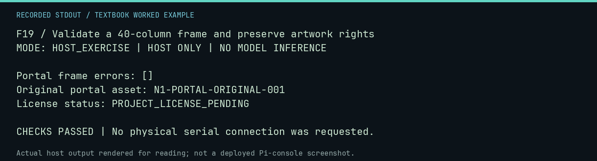

# F19 worked lab: Validate a 40-column frame and preserve artwork rights

**Goal:** Validate a 40-column frame and preserve artwork rights.

**Mode:** `HOST_EXERCISE`. This companion runs on the host; it does not
change the original packet's paper activity or authorize physical Replica work.

## Understand the example

Visual formatting has executable constraints, while permission to redistribute an image is a separate provenance question. Validate the original text portal without treating an external reference as a licensed project asset.

## Predict before running

Read the source below. Write down the expected printed values and the condition
that would make its checks fail. For a CPU trace, distinguish state before an
instruction from state after it. For a conceptual exercise, explain the rule
behind each classification rather than memorizing the printed label.

## Run it

From the checkout root with your environment active:

```bash
python -m tools.textbook run F19
```

The runner executes this [complete source](../examples/F19.py):

```python
import json

from neural1.interface import PORTAL_FRAME
from neural1.visualization import validate_frame
from tools.textbook_support import ROOT

errors = validate_frame(PORTAL_FRAME)
print("Portal frame errors:", errors)
r = json.loads((ROOT / "art/provenance/portal-original.json").read_text())
print("Original portal asset:", r["asset_id"])
print("License status:", r["license_status"])
assert not errors and r["origin"] == "original"
```

## Recorded result

This output was actually executed and checked. The image is a readable render
of that stdout, not a screenshot of the deployed Pi console. A teaching fixture
or a host analogue is not independent historical or physical evidence.

```text
F19 / Validate a 40-column frame and preserve artwork rights
MODE: HOST_EXERCISE | HOST ONLY | NO MODEL INFERENCE

Portal frame errors: []
Original portal asset: N1-PORTAL-ORIGINAL-001
License status: PROJECT_LICENSE_PENDING

CHECKS PASSED | No physical serial connection was requested.
```



[Raw output](../captures/F19.txt) · [Capture manifest](../captures/manifest.json)

## Change one thing

Why is fitting a 40-column frame unrelated to redistribution permission?

<details>
<summary>Compare your reasoning with the worked answer</summary>

One checks formatting; the other depends on authorship, rights, and permission records.

</details>

## Check your understanding

Explain the result without reading the code aloud. Name one condition that the
example did not test. Keep your prediction, changed input, actual output, and
interpretation together in your lab notebook. Use the linked textbook chapter
and the original source records for the broader context and evidence limits.

[Textbook home](../README.md) · Previous: [F18: Separate portal navigation from a physical launcher](F18.md) · Next: [F20: Read display modes without executing deployment controls](F20.md)
