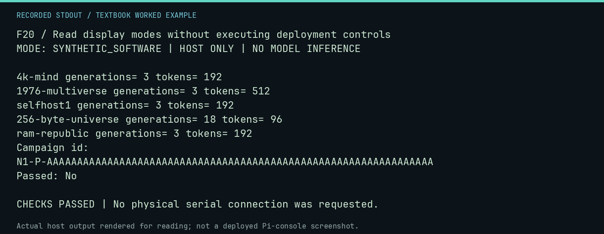

# F20 worked lab: Read display modes without executing deployment controls

**Goal:** Read display modes without executing deployment controls.

**Mode:** `SYNTHETIC_SOFTWARE`. This companion runs on the host; it does not
change the original packet's paper activity or authorize physical Replica work.

## Understand the example

The same recorded data can have human-readable or JSON presentation. Long IDs must remain copyable. This exercises the actual presentation function and the resource-bounded preset definitions; it does not launch a worker.

## Predict before running

Read the source below. Write down the expected printed values and the condition
that would make its checks fail. For a CPU trace, distinguish state before an
instruction from state after it. For a conceptual exercise, explain the rule
behind each classification rather than memorizing the printed label.

## Run it

From the checkout root with your environment active:

```bash
python -m tools.textbook run F20
```

The runner executes this [complete source](../examples/F20.py):

```python
from neural1.application import preset
from neural1.console_ui import render_result

for family in ("4k-mind", "1976-multiverse", "selfhost1", "256-byte-universe", "ram-republic"):
    spec = preset(family, "fixture", seed=7)
    print(family, "generations=", spec.generations, "tokens=", spec.max_tokens)
text = render_result({"campaign_id": "N1-P-" + "A" * 64, "passed": False}, width=40)
print(text)
assert "N1-P-" + "A" * 64 in text and "Passed: No" in text
```

## Recorded result

This output was actually executed and checked. The image is a readable render
of that stdout, not a screenshot of the deployed Pi console. A teaching fixture
or a host analogue is not independent historical or physical evidence.

```text
F20 / Read display modes without executing deployment controls
MODE: SYNTHETIC_SOFTWARE | HOST ONLY | NO MODEL INFERENCE

4k-mind generations= 3 tokens= 192
1976-multiverse generations= 3 tokens= 512
selfhost1 generations= 3 tokens= 192
256-byte-universe generations= 18 tokens= 96
ram-republic generations= 3 tokens= 192
Campaign id:
N1-P-AAAAAAAAAAAAAAAAAAAAAAAAAAAAAAAAAAAAAAAAAAAAAAAAAAAAAAAAAAAAAAAA
Passed: No

CHECKS PASSED | No physical serial connection was requested.
```



[Raw output](../captures/F20.txt) · [Capture manifest](../captures/manifest.json)

## Change one thing

Why should the display preserve a negative passed field?

<details>
<summary>Compare your reasoning with the worked answer</summary>

Readable presentation must not turn completed execution into a claim of success.

</details>

## Check your understanding

Explain the result without reading the code aloud. Name one condition that the
example did not test. Keep your prediction, changed input, actual output, and
interpretation together in your lab notebook. Use the linked textbook chapter
and the original source records for the broader context and evidence limits.

[Textbook home](../README.md) · Previous: [F19: Validate a 40-column frame and preserve artwork rights](F19.md) · Next: [F21: Inspect a local-provider request using a mock transport](F21.md)
