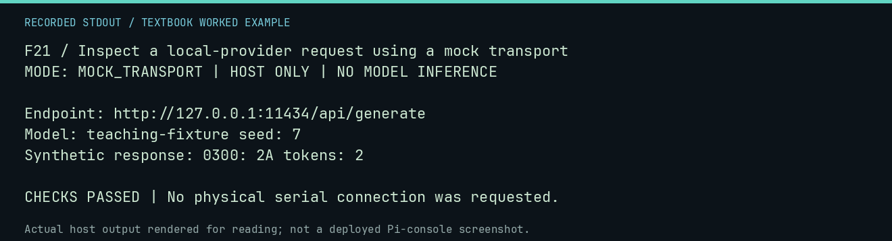

# F21 worked lab: Inspect a local-provider request using a mock transport

**Goal:** Inspect a local-provider request using a mock transport.

**Mode:** `MOCK_TRANSPORT`. This companion runs on the host; it does not
change the original packet's paper activity or authorize physical Replica work.

## Understand the example

The real Ollama adapter constructs a request to a loopback endpoint. The injected opener below checks that request and supplies a synthetic reply. This is a transport contract demonstration; it does not contact Ollama or infer tokens.

## Predict before running

Read the source below. Write down the expected printed values and the condition
that would make its checks fail. For a CPU trace, distinguish state before an
instruction from state after it. For a conceptual exercise, explain the rule
behind each classification rather than memorizing the printed label.

## Run it

From the checkout root with your environment active:

```bash
python -m tools.textbook run F21
```

The runner executes this [complete source](../examples/F21.py):

```python
import json

from neural1.models import OllamaHttpProvider

seen = []


def opener(request, timeout):
    payload = json.loads(request.data)
    seen.append(payload)
    print("Endpoint:", request.full_url)
    print("Model:", payload["model"], "seed:", payload["options"]["seed"])
    return json.dumps({"response": "0300: 2A", "prompt_eval_count": 3, "eval_count": 2}).encode()


r = OllamaHttpProvider("teaching-fixture", opener=opener).generate("READ", agent_id="A", seed=7)
print("Synthetic response:", r.text, "tokens:", r.completion_tokens)
assert r.completion_tokens == 2 and seen[0]["options"]["seed"] == 7
```

## Recorded result

This output was actually executed and checked. The image is a readable render
of that stdout, not a screenshot of the deployed Pi console. A teaching fixture
or a host analogue is not independent historical or physical evidence.

```text
F21 / Inspect a local-provider request using a mock transport
MODE: MOCK_TRANSPORT | HOST ONLY | NO MODEL INFERENCE

Endpoint: http://127.0.0.1:11434/api/generate
Model: teaching-fixture seed: 7
Synthetic response: 0300: 2A tokens: 2

CHECKS PASSED | No physical serial connection was requested.
```



[Raw output](../captures/F21.txt) · [Capture manifest](../captures/manifest.json)

## Change one thing

How would a real request differ?

<details>
<summary>Compare your reasoning with the worked answer</summary>

It would use an existing qualified local model and the actual service, with resource checks, bounded generation, and retained recordings.

</details>

## Check your understanding

Explain the result without reading the code aloud. Name one condition that the
example did not test. Keep your prediction, changed input, actual output, and
interpretation together in your lab notebook. Use the linked textbook chapter
and the original source records for the broader context and evidence limits.

[Textbook home](../README.md) · Previous: [F20: Read display modes without executing deployment controls](F20.md) · Next: [F22: Check a preserved program source without writing a card](F22.md)
