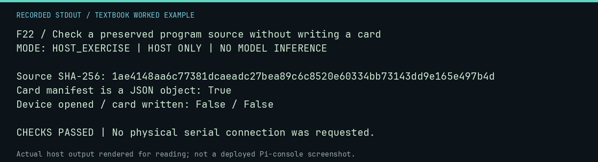

# F22 worked lab: Check a preserved program source without writing a card

**Goal:** Check a preserved program source without writing a card.

**Mode:** `HOST_EXERCISE`. This companion runs on the host; it does not
change the original packet's paper activity or authorize physical Replica work.

## Understand the example

The host-side CF flow begins with a source manifest and explicit approval. A source file hash can be inspected independently of export or deployment. This example reads only the existing RAM artifact and card manifest.

## Predict before running

Read the source below. Write down the expected printed values and the condition
that would make its checks fail. For a CPU trace, distinguish state before an
instruction from state after it. For a conceptual exercise, explain the rule
behind each classification rather than memorizing the printed label.

## Run it

From the checkout root with your environment active:

```bash
python -m tools.textbook run F22
```

The runner executes this [complete source](../examples/F22.py):

```python
import json
from hashlib import sha256

from tools.textbook_support import ROOT

p = ROOT / "software/ram-only/line-input-0300.hex"
manifest = json.loads((ROOT / "cf-card/manifests/current.json").read_text())
print("Source SHA-256:", sha256(p.read_bytes()).hexdigest())
print("Card manifest is a JSON object:", isinstance(manifest, dict))
print("Device opened / card written: False / False")
assert isinstance(manifest, dict)
```

## Recorded result

This output was actually executed and checked. The image is a readable render
of that stdout, not a screenshot of the deployed Pi console. A teaching fixture
or a host analogue is not independent historical or physical evidence.

```text
F22 / Check a preserved program source without writing a card
MODE: HOST_EXERCISE | HOST ONLY | NO MODEL INFERENCE

Source SHA-256: 1ae4148aa6c77381dcaeadc27bea89c6c8520e60334bb73143dd9e165e497b4d
Card manifest is a JSON object: True
Device opened / card written: False / False

CHECKS PASSED | No physical serial connection was requested.
```



[Raw output](../captures/F22.txt) · [Capture manifest](../captures/manifest.json)

## Change one thing

What is the next safe step after reviewing a manifest?

<details>
<summary>Compare your reasoning with the worked answer</summary>

Host-side staging of approved sources, following the exporter guide. Staging is not physical-card deployment.

</details>

## Check your understanding

Explain the result without reading the code aloud. Name one condition that the
example did not test. Keep your prediction, changed input, actual output, and
interpretation together in your lab notebook. Use the linked textbook chapter
and the original source records for the broader context and evidence limits.

[Textbook home](../README.md) · Previous: [F21: Inspect a local-provider request using a mock transport](F21.md) · Next: [F23: Rebuild a synthetic SELFHOST archive artifact](F23.md)
