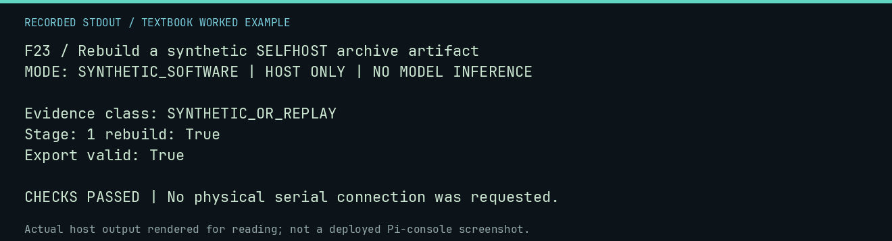

# F23 worked lab: Rebuild a synthetic SELFHOST archive artifact

**Goal:** Rebuild a synthetic SELFHOST archive artifact.

**Mode:** `SYNTHETIC_SOFTWARE`. This companion runs on the host; it does not
change the original packet's paper activity or authorize physical Replica work.

## Understand the example

The persistent archive retains reconstruction evidence and ancestry. This deliberately synthetic stage-one run deposits a known routine. The archive ingests it, rebuilds it, and verifies a dependency-closed export; it does not invent a compiler.

## Predict before running

Read the source below. Write down the expected printed values and the condition
that would make its checks fail. For a CPU trace, distinguish state before an
instruction from state after it. For a conceptual exercise, explain the rule
behind each classification rather than memorizing the printed label.

## Run it

From the checkout root with your environment active:

```bash
python -m tools.textbook run F23
```

The runner executes this [complete source](../examples/F23.py):

```python
import json
from pathlib import Path
from tempfile import TemporaryDirectory

from neural1.core import sha256_bytes
from neural1.selfhost_workflow import SelfHostArchive, verify_export
from neural1.world import VirtualApple1World, WozMonSession

with TemporaryDirectory() as d:
    root = Path(d)
    run = root / "run"
    cell = run / "cells/CELL"
    cell.mkdir(parents=True)
    commands = ["0200: A9 41 20 EF FF 4C 1F FF", "0200R"]
    world = VirtualApple1World()
    record = {
        "generation": 0,
        "agent_id": "SYNTHETIC",
        "response": "\n".join(commands),
        "outputs": [WozMonSession(world).transact(c) for c in commands],
    }
    transcript = (json.dumps(record) + "\n").encode()
    (cell / "transcript.jsonl").write_bytes(transcript)
    (cell / "checkpoint.json").write_text(json.dumps({"status": "COMPLETED", "transcript_sha256": sha256_bytes(transcript)}))
    (cell / "family-result.json").write_text(
        json.dumps({"family": "selfhost1", "passed": True, "artifact_sha256": sha256_bytes(world.host_read(0x200, 4096))})
    )
    (run / "spec.json").write_text(json.dumps({"experiments": ["selfhost1"], "ram_budget": 4096}))
    (run / "effective-registry.json").write_text(json.dumps({"models": [{"backend": "fake"}]}))
    archive = SelfHostArchive(root / "archive")
    artifact = archive.ingest_run(run)[0]
    print("Evidence class:", artifact["evidence_class"])
    print("Stage:", artifact["stage"], "rebuild:", archive.rebuild(artifact["artifact_id"])["passed"])
    archive.export(root / "export", [artifact["artifact_id"]])
    print("Export valid:", verify_export(root / "export")["valid"])
    assert artifact["stage"] == 1 and verify_export(root / "export")["valid"]
```

## Recorded result

This output was actually executed and checked. The image is a readable render
of that stdout, not a screenshot of the deployed Pi console. A teaching fixture
or a host analogue is not independent historical or physical evidence.

```text
F23 / Rebuild a synthetic SELFHOST archive artifact
MODE: SYNTHETIC_SOFTWARE | HOST ONLY | NO MODEL INFERENCE

Evidence class: SYNTHETIC_OR_REPLAY
Stage: 1 rebuild: True
Export valid: True

CHECKS PASSED | No physical serial connection was requested.
```



[Raw output](../captures/F23.txt) · [Capture manifest](../captures/manifest.json)

## Change one thing

What is additionally required before later-stage qualification?

<details>
<summary>Compare your reasoning with the worked answer</summary>

Qualified parent ancestry, a retained builder, exact repeat reconstruction, independently declared behavioral tests, and controls. Stage one alone supplies none of those later claims.

</details>

## Check your understanding

Explain the result without reading the code aloud. Name one condition that the
example did not test. Keep your prediction, changed input, actual output, and
interpretation together in your lab notebook. Use the linked textbook chapter
and the original source records for the broader context and evidence limits.

[Textbook home](../README.md) · Previous: [F22: Check a preserved program source without writing a card](F22.md) · Next: [F24: Copy and verify a migration using disposable fixture directories](F24.md)
