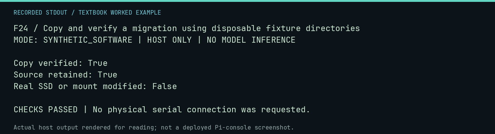

# F24 worked lab: Copy and verify a migration using disposable fixture directories

**Goal:** Copy and verify a migration using disposable fixture directories.

**Mode:** `SYNTHETIC_SOFTWARE`. This companion runs on the host; it does not
change the original packet's paper activity or authorize physical Replica work.

## Understand the example

The storage workflow separates planning, copying, and verification. This example creates its own marked temporary directories and tiny fixture file. It does not identify a real SSD, change mounts, format a device, or finalize deletion of user data.

## Predict before running

Read the source below. Write down the expected printed values and the condition
that would make its checks fail. For a CPU trace, distinguish state before an
instruction from state after it. For a conceptual exercise, explain the rule
behind each classification rather than memorizing the printed label.

## Run it

From the checkout root with your environment active:

```bash
python -m tools.textbook run F24
```

The runner executes this [complete source](../examples/F24.py):

```python
from pathlib import Path
from tempfile import TemporaryDirectory

from neural1.storage_commissioning import (
    SSD_ROLE,
    build_migration_manifest,
    copy_migration,
    initialize_ssd_root,
    initialize_temporary_root,
    verify_migration,
)

with TemporaryDirectory() as d:
    root = Path(d)
    source = root / "temporary"
    destination = root / "fixture-destination"
    destination.mkdir()
    initialize_temporary_root(source)
    initialize_ssd_root(destination, volume_id="DISPOSABLE-TEXTBOOK-FIXTURE", confirmation=SSD_ROLE)
    (source / "lesson.txt").write_text("PRESERVE THESE BYTES")
    manifest = build_migration_manifest(source, destination)
    copied = copy_migration(manifest)
    verify_migration(copied)
    assert (source / "lesson.txt").read_bytes() == (destination / "lesson.txt").read_bytes()
    print("Copy verified: True")
    print("Source retained:", (source / "lesson.txt").exists())
    print("Real SSD or mount modified: False")
```

## Recorded result

This output was actually executed and checked. The image is a readable render
of that stdout, not a screenshot of the deployed Pi console. A teaching fixture
or a host analogue is not independent historical or physical evidence.

```text
F24 / Copy and verify a migration using disposable fixture directories
MODE: SYNTHETIC_SOFTWARE | HOST ONLY | NO MODEL INFERENCE

Copy verified: True
Source retained: True
Real SSD or mount modified: False

CHECKS PASSED | No physical serial connection was requested.
```



[Raw output](../captures/F24.txt) · [Capture manifest](../captures/manifest.json)

## Change one thing

Why not finalize deletion as the first teaching step?

<details>
<summary>Compare your reasoning with the worked answer</summary>

Verification and an independent retained copy come first. Finalization is a separately guarded operator action, not a requirement for learning copy integrity.

</details>

## Check your understanding

Explain the result without reading the code aloud. Name one condition that the
example did not test. Keep your prediction, changed input, actual output, and
interpretation together in your lab notebook. Use the linked textbook chapter
and the original source records for the broader context and evidence limits.

[Textbook home](../README.md) · Previous: [F23: Rebuild a synthetic SELFHOST archive artifact](F23.md) · Next: [F25: Observe a deployment guard refusing an ordinary directory](F25.md)
