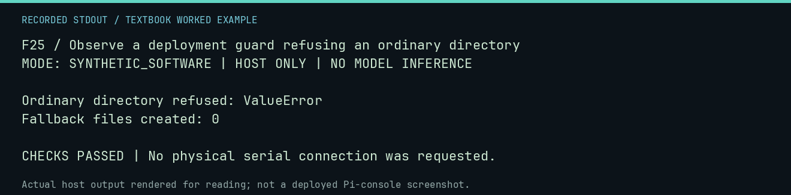

# F25 worked lab: Observe a deployment guard refusing an ordinary directory

**Goal:** Observe a deployment guard refusing an ordinary directory.

**Mode:** `SYNTHETIC_SOFTWARE`. This companion runs on the host; it does not
change the original packet's paper activity or authorize physical Replica work.

## Understand the example

A directory with a familiar name is not necessarily the commissioned volume. This example invokes the actual storage verification guard with a freshly created ordinary directory. Rejection is the expected success of the guard.

## Predict before running

Read the source below. Write down the expected printed values and the condition
that would make its checks fail. For a CPU trace, distinguish state before an
instruction from state after it. For a conceptual exercise, explain the rule
behind each classification rather than memorizing the printed label.

## Run it

From the checkout root with your environment active:

```bash
python -m tools.textbook run F25
```

The runner executes this [complete source](../examples/F25.py):

```python
from pathlib import Path
from tempfile import TemporaryDirectory

from neural1.deployment import verify_storage

with TemporaryDirectory() as d:
    path = Path(d) / "not-an-ssd"
    path.mkdir()
    try:
        verify_storage(path, "TEXTBOOK-NOT-A-REAL-UUID")
        raise AssertionError("ordinary directory must be refused")
    except (ValueError, OSError) as error:
        print("Ordinary directory refused:", type(error).__name__)
    assert list(path.iterdir()) == []
    print("Fallback files created: 0")
```

## Recorded result

This output was actually executed and checked. The image is a readable render
of that stdout, not a screenshot of the deployed Pi console. A teaching fixture
or a host analogue is not independent historical or physical evidence.

```text
F25 / Observe a deployment guard refusing an ordinary directory
MODE: SYNTHETIC_SOFTWARE | HOST ONLY | NO MODEL INFERENCE

Ordinary directory refused: ValueError
Fallback files created: 0

CHECKS PASSED | No physical serial connection was requested.
```



[Raw output](../captures/F25.txt) · [Capture manifest](../captures/manifest.json)

## Change one thing

Why check a filesystem identity rather than only free space?

<details>
<summary>Compare your reasoning with the worked answer</summary>

A missing mount can leave an ordinary directory on another disk. Plenty of free space on the wrong disk does not make the destination correct.

</details>

## Check your understanding

Explain the result without reading the code aloud. Name one condition that the
example did not test. Keep your prediction, changed input, actual output, and
interpretation together in your lab notebook. Use the linked textbook chapter
and the original source records for the broader context and evidence limits.

[Textbook home](../README.md) · Previous: [F24: Copy and verify a migration using disposable fixture directories](F24.md) · Next: [F26: Inspect research staging without promoting it](F26.md)
