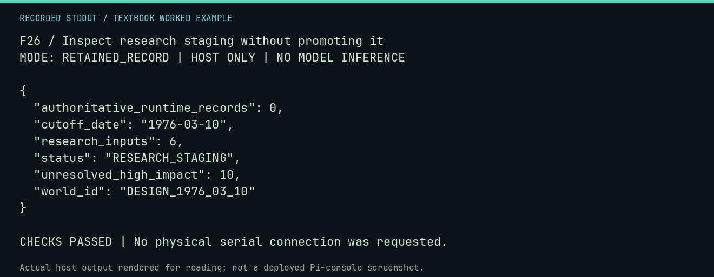

# F26 worked lab: Inspect research staging without promoting it

**Goal:** Inspect research staging without promoting it.

**Mode:** `RETAINED_RECORD`. This companion runs on the host; it does not
change the original packet's paper activity or authorize physical Replica work.

## Understand the example

The historical research index carries an explicit status and authoritative-record count. Reading or validating that file does not promote its claims. This capture reflects the committed staging index, separate from the reviewed console corpus.

## Predict before running

Read the source below. Write down the expected printed values and the condition
that would make its checks fail. For a CPU trace, distinguish state before an
instruction from state after it. For a conceptual exercise, explain the rule
behind each classification rather than memorizing the printed label.

## Run it

From the checkout root with your environment active:

```bash
python -m tools.textbook run F26
```

The runner executes this [complete source](../examples/F26.py):

```python
from neural1.history import research_status
from tools.textbook_support import ROOT, emit

status = research_status(ROOT / "data/neural1/history/1976-research-index.json")
emit(status)
assert isinstance(status, dict)
```

## Recorded result

This output was actually executed and checked. The image is a readable render
of that stdout, not a screenshot of the deployed Pi console. A teaching fixture
or a host analogue is not independent historical or physical evidence.

```text
F26 / Inspect research staging without promoting it
MODE: RETAINED_RECORD | HOST ONLY | NO MODEL INFERENCE

{
  "authoritative_runtime_records": 0,
  "cutoff_date": "1976-03-10",
  "research_inputs": 6,
  "status": "RESEARCH_STAGING",
  "unresolved_high_impact": 10,
  "world_id": "DESIGN_1976_03_10"
}

CHECKS PASSED | No physical serial connection was requested.
```



[Raw output](../captures/F26.txt) · [Capture manifest](../captures/manifest.json)

## Change one thing

What would justify promotion of a historical component?

<details>
<summary>Compare your reasoning with the worked answer</summary>

The documented source, hash, claim, date-cutoff, and review gates; model-generated estimates are not a substitute.

</details>

## Check your understanding

Explain the result without reading the code aloud. Name one condition that the
example did not test. Keep your prediction, changed input, actual output, and
interpretation together in your lab notebook. Use the linked textbook chapter
and the original source records for the broader context and evidence limits.

[Textbook home](../README.md) · Previous: [F25: Observe a deployment guard refusing an ordinary directory](F25.md) · Next: [L01: Read token accounting without confusing words and tokens](L01.md)
