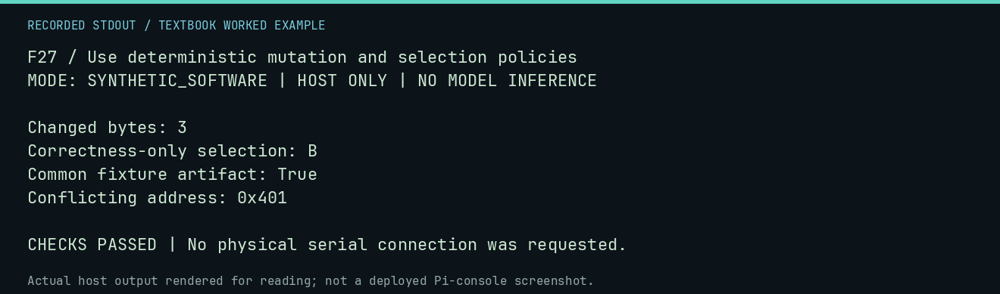

# F27 worked lab: Use deterministic mutation and selection policies

**Goal:** Use deterministic mutation and selection policies.

**Mode:** `SYNTHETIC_SOFTWARE`. This companion runs on the host; it does not
change the original packet's paper activity or authorize physical Replica work.

## Understand the example

Mutation, selection, conflict accounting, and convergence are explicit policies. The seed makes an authored mutation repeatable; a shared artifact does not establish a causal explanation for convergence.

## Predict before running

Read the source below. Write down the expected printed values and the condition
that would make its checks fail. For a CPU trace, distinguish state before an
instruction from state after it. For a conceptual exercise, explain the rule
behind each classification rather than memorizing the printed label.

## Run it

From the checkout root with your environment active:

```bash
python -m tools.textbook run F27
```

The runner executes this [complete source](../examples/F27.py):

```python
from neural1.policies import CandidateMetrics, SelectionPolicy, convergence, memory_conflicts, mutate_rom

one, record = mutate_rom(bytes(256), seed=7, mutation_count=3)
two, other = mutate_rom(bytes(256), seed=7, mutation_count=3)
assert one == two and record == other
print("Changed bytes:", sum(a != b for a, b in zip(bytes(256), one, strict=True)))
candidates = [CandidateMetrics("A", 0.5, 1, 10, 20, 1), CandidateMetrics("B", 1, 0.5, 20, 10, 0.5)]
print("Correctness-only selection:", SelectionPolicy().select(candidates, 1)[0].candidate_id)
print("Common fixture artifact:", convergence({"A": ["HASH"], "B": ["HASH"]})["converged"])
print("Conflicting address:", hex(memory_conflicts([("A", 0x400, b"AB"), ("B", 0x401, b"C")])[0].address))
```

## Recorded result

This output was actually executed and checked. The image is a readable render
of that stdout, not a screenshot of the deployed Pi console. A teaching fixture
or a host analogue is not independent historical or physical evidence.

```text
F27 / Use deterministic mutation and selection policies
MODE: SYNTHETIC_SOFTWARE | HOST ONLY | NO MODEL INFERENCE

Changed bytes: 3
Correctness-only selection: B
Common fixture artifact: True
Conflicting address: 0x401

CHECKS PASSED | No physical serial connection was requested.
```



[Raw output](../captures/F27.txt) · [Capture manifest](../captures/manifest.json)

## Change one thing

Would changing the score weights change what counts as the best candidate?

<details>
<summary>Compare your reasoning with the worked answer</summary>

Yes. Declare the weights before inspecting candidates and retain them as part of the experiment.

</details>

## Check your understanding

Explain the result without reading the code aloud. Name one condition that the
example did not test. Keep your prediction, changed input, actual output, and
interpretation together in your lab notebook. Use the linked textbook chapter
and the original source records for the broader context and evidence limits.

[Textbook home](../README.md) · Previous: [L08: Use negative controls before widening a claim](L08.md) · Next: [F28: Inspect a llama.cpp command without executing a binary](F28.md)
