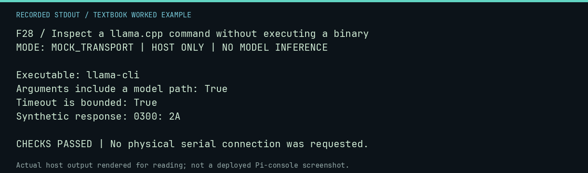

# F28 worked lab: Inspect a llama.cpp command without executing a binary

**Goal:** Inspect a llama.cpp command without executing a binary.

**Mode:** `MOCK_TRANSPORT`. This companion runs on the host; it does not
change the original packet's paper activity or authorize physical Replica work.

## Understand the example

The real adapter uses an argument array and bounded runner. An injected runner records the invocation and supplies a fixture response; there is no model binary or GGUF file opened in this lab.

## Predict before running

Read the source below. Write down the expected printed values and the condition
that would make its checks fail. For a CPU trace, distinguish state before an
instruction from state after it. For a conceptual exercise, explain the rule
behind each classification rather than memorizing the printed label.

## Run it

From the checkout root with your environment active:

```bash
python -m tools.textbook run F28
```

The runner executes this [complete source](../examples/F28.py):

```python
from pathlib import Path

from neural1.models import LlamaCppProvider

seen = []


def runner(command, timeout):
    seen.append(command)
    print("Executable:", command[0])
    print("Arguments include a model path:", "-m" in command)
    print("Timeout is bounded:", timeout > 0)
    return "0300: 2A", ""


r = LlamaCppProvider(Path("llama-cli"), Path("fixture.gguf"), "a" * 64, runner=runner).generate("READ", agent_id="A", seed=7)
print("Synthetic response:", r.text)
assert r.text == "0300: 2A" and seen
```

## Recorded result

This output was actually executed and checked. The image is a readable render
of that stdout, not a screenshot of the deployed Pi console. A teaching fixture
or a host analogue is not independent historical or physical evidence.

```text
F28 / Inspect a llama.cpp command without executing a binary
MODE: MOCK_TRANSPORT | HOST ONLY | NO MODEL INFERENCE

Executable: llama-cli
Arguments include a model path: True
Timeout is bounded: True
Synthetic response: 0300: 2A

CHECKS PASSED | No physical serial connection was requested.
```



[Raw output](../captures/F28.txt) · [Capture manifest](../captures/manifest.json)

## Change one thing

Why use an argument array rather than concatenate a shell command?

<details>
<summary>Compare your reasoning with the worked answer</summary>

It preserves argument boundaries and avoids interpreting model or path text as shell syntax.

</details>

## Check your understanding

Explain the result without reading the code aloud. Name one condition that the
example did not test. Keep your prediction, changed input, actual output, and
interpretation together in your lab notebook. Use the linked textbook chapter
and the original source records for the broader context and evidence limits.

[Textbook home](../README.md) · Previous: [F27: Use deterministic mutation and selection policies](F27.md) · Next: [F29: Stage only approved CF sources in a disposable directory](F29.md)
