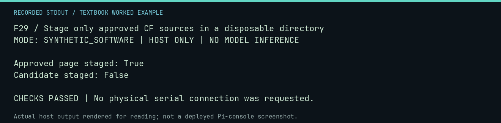

# F29 worked lab: Stage only approved CF sources in a disposable directory

**Goal:** Stage only approved CF sources in a disposable directory.

**Mode:** `SYNTHETIC_SOFTWARE`. This companion runs on the host; it does not
change the original packet's paper activity or authorize physical Replica work.

## Understand the example

The actual exporter reads explicit approval fields. This fixture has one approved source and one candidate. It checks that staging copies the approved page and leaves the candidate out, without writing a card.

## Predict before running

Read the source below. Write down the expected printed values and the condition
that would make its checks fail. For a CPU trace, distinguish state before an
instruction from state after it. For a conceptual exercise, explain the rule
behind each classification rather than memorizing the printed label.

## Run it

From the checkout root with your environment active:

```bash
python -m tools.textbook run F29
```

The runner executes this [complete source](../examples/F29.py):

```python
from pathlib import Path
from tempfile import TemporaryDirectory

from tools.export_cf_card_sources import export_sources

with TemporaryDirectory() as d:
    root = Path(d)
    repo = root / "repo"
    for name in ("approved", "candidate", "baseline"):
        (repo / name).mkdir(parents=True)
    (repo / "approved/page.txt").write_text("READY\n")
    (repo / "candidate/page.txt").write_text("CANDIDATE\n")
    (repo / "baseline/MANIFEST.md").write_text("FIXTURE BASELINE")
    manifest = {
        "baseline": {"manifest_path": "baseline/MANIFEST.md", "image_path": "baseline/absent.img", "size_bytes": 0, "sha256": "0" * 64},
        "sources": [
            {"source_path": "approved", "staging_path": "overlay", "format": "ascii-40x24", "include_in_default_export": True},
            {"source_path": "candidate", "staging_path": "candidate", "format": "mixed", "include_in_default_export": False},
        ],
    }
    export_sources(repo, manifest, root / "staged")
    print("Approved page staged:", (root / "staged/overlay/page.txt").exists())
    print("Candidate staged:", (root / "staged/candidate").exists())
    assert (root / "staged/overlay/page.txt").exists() and not (root / "staged/candidate").exists()
```

## Recorded result

This output was actually executed and checked. The image is a readable render
of that stdout, not a screenshot of the deployed Pi console. A teaching fixture
or a host analogue is not independent historical or physical evidence.

```text
F29 / Stage only approved CF sources in a disposable directory
MODE: SYNTHETIC_SOFTWARE | HOST ONLY | NO MODEL INFERENCE

Approved page staged: True
Candidate staged: False

CHECKS PASSED | No physical serial connection was requested.
```



[Raw output](../captures/F29.txt) · [Capture manifest](../captures/manifest.json)

## Change one thing

Does this promote any real lesson to card-approved status?

<details>
<summary>Compare your reasoning with the worked answer</summary>

No. The approval fields and sources in this lab are disposable fixtures.

</details>

## Check your understanding

Explain the result without reading the code aloud. Name one condition that the
example did not test. Keep your prediction, changed input, actual output, and
interpretation together in your lab notebook. Use the linked textbook chapter
and the original source records for the broader context and evidence limits.

[Textbook home](../README.md) · Previous: [F28: Inspect a llama.cpp command without executing a binary](F28.md) · Next: [F30: Audit candidate firmware source without loading firmware](F30.md)
