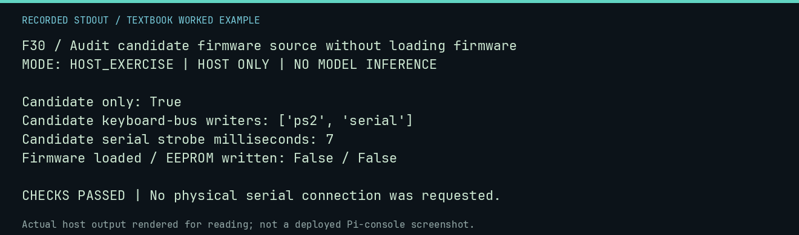

# F30 worked lab: Audit candidate firmware source without loading firmware

**Goal:** Audit candidate firmware source without loading firmware.

**Mode:** `HOST_EXERCISE`. This companion runs on the host; it does not
change the original packet's paper activity or authorize physical Replica work.

## Understand the example

The static auditor inspects archived source declarations. Its result is explicitly candidate-only. Source pin constants and writer routines do not identify installed EEPROM contents, safe probe points, or the actual cause of a hardware fault.

## Predict before running

Read the source below. Write down the expected printed values and the condition
that would make its checks fail. For a CPU trace, distinguish state before an
instruction from state after it. For a conceptual exercise, explain the rule
behind each classification rather than memorizing the printed label.

## Run it

From the checkout root with your environment active:

```bash
python -m tools.textbook run F30
```

The runner executes this [complete source](../examples/F30.py):

```python
from tools.firmware_static_audit import audit_vendor_source
from tools.textbook_support import ROOT

r = audit_vendor_source(ROOT / "firmware/vendor/110REV03")
print("Candidate only:", r["candidate_only"])
print("Candidate keyboard-bus writers:", sorted(r["keyboard_bus_writers"]))
print("Candidate serial strobe milliseconds:", r["serial_strobe_ms"])
assert r["candidate_only"] and r["keyboard_bus_writers"] == {"ps2", "serial"}
print("Firmware loaded / EEPROM written: False / False")
```

## Recorded result

This output was actually executed and checked. The image is a readable render
of that stdout, not a screenshot of the deployed Pi console. A teaching fixture
or a host analogue is not independent historical or physical evidence.

```text
F30 / Audit candidate firmware source without loading firmware
MODE: HOST_EXERCISE | HOST ONLY | NO MODEL INFERENCE

Candidate only: True
Candidate keyboard-bus writers: ['ps2', 'serial']
Candidate serial strobe milliseconds: 7
Firmware loaded / EEPROM written: False / False

CHECKS PASSED | No physical serial connection was requested.
```



[Raw output](../captures/F30.txt) · [Capture manifest](../captures/manifest.json)

## Change one thing

What evidence would connect this source to the installed firmware?

<details>
<summary>Compare your reasoning with the worked answer</summary>

A separately verified identity and readback/provenance procedure; static source inspection alone cannot do so.

</details>

## Check your understanding

Explain the result without reading the code aloud. Name one condition that the
example did not test. Keep your prediction, changed input, actual output, and
interpretation together in your lab notebook. Use the linked textbook chapter
and the original source records for the broader context and evidence limits.

[Textbook home](../README.md) · Previous: [F29: Stage only approved CF sources in a disposable directory](F29.md) · Next: [F31: Reject incomplete capture metadata](F31.md)
