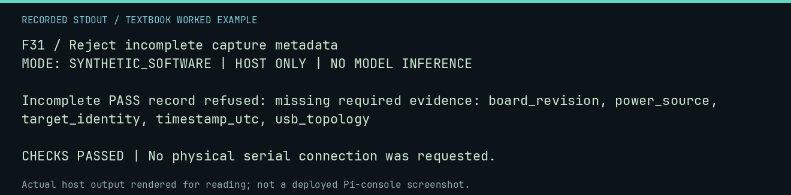

# F31 worked lab: Reject incomplete capture metadata

**Goal:** Reject incomplete capture metadata.

**Mode:** `SYNTHETIC_SOFTWARE`. This companion runs on the host; it does not
change the original packet's paper activity or authorize physical Replica work.

## Understand the example

A capture needs enough context to support interpretation. The validator should reject an incomplete object even when its result says PASS. This lab creates no physical capture and verifies no probe placement.

## Predict before running

Read the source below. Write down the expected printed values and the condition
that would make its checks fail. For a CPU trace, distinguish state before an
instruction from state after it. For a conceptual exercise, explain the rule
behind each classification rather than memorizing the printed label.

## Run it

From the checkout root with your environment active:

```bash
python -m tools.textbook run F31
```

The runner executes this [complete source](../examples/F31.py):

```python
from tools.capture_manifest import ManifestValidationError, validate_manifest

try:
    validate_manifest({"result": "PASS"})
    raise AssertionError("incomplete evidence must fail")
except ManifestValidationError as error:
    print("Incomplete PASS record refused:", str(error))
```

## Recorded result

This output was actually executed and checked. The image is a readable render
of that stdout, not a screenshot of the deployed Pi console. A teaching fixture
or a host analogue is not independent historical or physical evidence.

```text
F31 / Reject incomplete capture metadata
MODE: SYNTHETIC_SOFTWARE | HOST ONLY | NO MODEL INFERENCE

Incomplete PASS record refused: missing required evidence: board_revision, power_source, target_identity, timestamp_utc, usb_topology

CHECKS PASSED | No physical serial connection was requested.
```



[Raw output](../captures/F31.txt) · [Capture manifest](../captures/manifest.json)

## Change one thing

Is a complete metadata object sufficient to establish that a measurement happened?

<details>
<summary>Compare your reasoning with the worked answer</summary>

No. Raw artifacts, identities, hashes, procedure, and interpretation still matter.

</details>

## Check your understanding

Explain the result without reading the code aloud. Name one condition that the
example did not test. Keep your prediction, changed input, actual output, and
interpretation together in your lab notebook. Use the linked textbook chapter
and the original source records for the broader context and evidence limits.

[Textbook home](../README.md) · Previous: [F30: Audit candidate firmware source without loading firmware](F30.md) · Next: [F32: Package only explicitly selected support evidence](F32.md)
