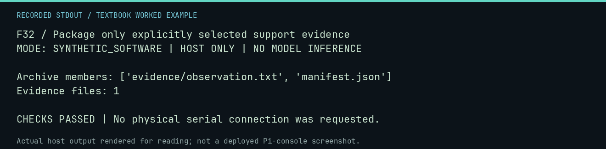

# F32 worked lab: Package only explicitly selected support evidence

**Goal:** Package only explicitly selected support evidence.

**Mode:** `SYNTHETIC_SOFTWARE`. This companion runs on the host; it does not
change the original packet's paper activity or authorize physical Replica work.

## Understand the example

The support-bundle tool copies explicit files into an archive with hashes. The teaching file is created in a disposable directory. No workstation logs, account data, serial devices, or private machine configuration are collected.

## Predict before running

Read the source below. Write down the expected printed values and the condition
that would make its checks fail. For a CPU trace, distinguish state before an
instruction from state after it. For a conceptual exercise, explain the rule
behind each classification rather than memorizing the printed label.

## Run it

From the checkout root with your environment active:

```bash
python -m tools.textbook run F32
```

The runner executes this [complete source](../examples/F32.py):

```python
import json
import zipfile
from pathlib import Path
from tempfile import TemporaryDirectory

from tools.support_bundle import build_support_bundle

with TemporaryDirectory() as d:
    p = Path(d)
    source = p / "observation.txt"
    source.write_text("TEXTBOOK FIXTURE")
    build_support_bundle(p / "support.zip", [source])
    with zipfile.ZipFile(p / "support.zip") as bundle:
        names = sorted(bundle.namelist())
        manifest = json.loads(bundle.read("manifest.json"))
    print("Archive members:", names)
    print("Evidence files:", len(manifest["files"]))
    assert len(manifest["files"]) == 1 and "evidence/observation.txt" in names
```

## Recorded result

This output was actually executed and checked. The image is a readable render
of that stdout, not a screenshot of the deployed Pi console. A teaching fixture
or a host analogue is not independent historical or physical evidence.

```text
F32 / Package only explicitly selected support evidence
MODE: SYNTHETIC_SOFTWARE | HOST ONLY | NO MODEL INFERENCE

Archive members: ['evidence/observation.txt', 'manifest.json']
Evidence files: 1

CHECKS PASSED | No physical serial connection was requested.
```



[Raw output](../captures/F32.txt) · [Capture manifest](../captures/manifest.json)

## Change one thing

Why should a support bundle require explicit paths?

<details>
<summary>Compare your reasoning with the worked answer</summary>

It limits collection scope and makes it possible to review exactly what is included before sharing.

</details>

## Check your understanding

Explain the result without reading the code aloud. Name one condition that the
example did not test. Keep your prediction, changed input, actual output, and
interpretation together in your lab notebook. Use the linked textbook chapter
and the original source records for the broader context and evidence limits.

[Textbook home](../README.md) · Previous: [F31: Reject incomplete capture metadata](F31.md) · Next: [F33: Interpret invariant mining as a candidate generator](F33.md)
