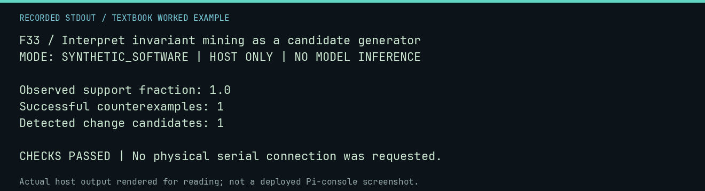

# F33 worked lab: Interpret invariant mining as a candidate generator

**Goal:** Interpret invariant mining as a candidate generator.

**Mode:** `SYNTHETIC_SOFTWARE`. This companion runs on the host; it does not
change the original packet's paper activity or authorize physical Replica work.

## Understand the example

A feature common to observed successes is a candidate pattern, not an automatically established cause. An independent successful counterexample can break it. Keep outcome classification and the population used in analysis explicit.

## Predict before running

Read the source below. Write down the expected printed values and the condition
that would make its checks fail. For a CPU trace, distinguish state before an
instruction from state after it. For a conceptual exercise, explain the rule
behind each classification rather than memorizing the printed label.

## Run it

From the checkout root with your environment active:

```bash
python -m tools.textbook run F33
```

The runner executes this [complete source](../examples/F33.py):

```python
from neural1.analysis import break_invariant, detect_phase_changes, mine_invariants

records = [{"successful": True, "checksum": True, "model": "A"}, {"successful": True, "checksum": True, "model": "B"}]
candidate = next(c for c in mine_invariants(records) if c.feature == "checksum")
print("Observed support fraction:", candidate.support_fraction)
counterexamples = break_invariant(candidate, [{"successful": True, "checksum": False}])
print("Successful counterexamples:", len(counterexamples))
print("Detected change candidates:", len(detect_phase_changes([0, 0.1, 2.0], threshold=1)))
assert len(counterexamples) == 1
```

## Recorded result

This output was actually executed and checked. The image is a readable render
of that stdout, not a screenshot of the deployed Pi console. A teaching fixture
or a host analogue is not independent historical or physical evidence.

```text
F33 / Interpret invariant mining as a candidate generator
MODE: SYNTHETIC_SOFTWARE | HOST ONLY | NO MODEL INFERENCE

Observed support fraction: 1.0
Successful counterexamples: 1
Detected change candidates: 1

CHECKS PASSED | No physical serial connection was requested.
```



[Raw output](../captures/F33.txt) · [Capture manifest](../captures/manifest.json)

## Change one thing

What would justify changing an observed pattern into a causal claim?

<details>
<summary>Compare your reasoning with the worked answer</summary>

A predeclared intervention/control design, appropriate uncertainty analysis, and replication, not a detector label alone.

</details>

## Check your understanding

Explain the result without reading the code aloud. Name one condition that the
example did not test. Keep your prediction, changed input, actual output, and
interpretation together in your lab notebook. Use the linked textbook chapter
and the original source records for the broader context and evidence limits.

[Textbook home](../README.md) · Previous: [F32: Package only explicitly selected support evidence](F32.md) · Next: [F34: Link a proof capsule to explicit falsification work](F34.md)
