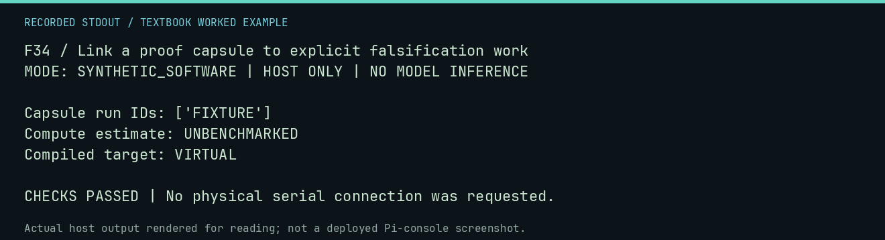

# F34 worked lab: Link a proof capsule to explicit falsification work

**Goal:** Link a proof capsule to explicit falsification work.

**Mode:** `SYNTHETIC_SOFTWARE`. This companion runs on the host; it does not
change the original packet's paper activity or authorize physical Replica work.

## Understand the example

A proof capsule packages the basis for a claim and its reproduction metadata. A falsification plan proposes an intervention. Neither creates a scientific finding simply because its data structure is valid.

## Predict before running

Read the source below. Write down the expected printed values and the condition
that would make its checks fail. For a CPU trace, distinguish state before an
instruction from state after it. For a conceptual exercise, explain the rule
behind each classification rather than memorizing the printed label.

## Run it

From the checkout root with your environment active:

```bash
python -m tools.textbook run F34
```

The runner executes this [complete source](../examples/F34.py):

```python
from neural1.meta import ClaimGraph, compile_experiment, falsification_plan, proof_capsule

g = ClaimGraph()
claim = g.create_claim("FIXTURE EFFECT", {"experiment": "synthetic"})
evidence = g.add_evidence("fixture", "a" * 64, ["FIXTURE"], "authored evidence")
g.relate(evidence.evidence_id, "supports", claim.claim_id)
capsule = proof_capsule(
    claim, g, dataset_hash="b" * 64, analysis_version="textbook", reproduction_command="python -m tools.textbook run F34"
)
plan = falsification_plan(claim, factor="X", control="0", treatment="1", metric="Y", seeds=[1], sample_count=2)
compiled = compile_experiment(
    "DOES X CHANGE Y?",
    factor="X",
    levels=["A", "B"],
    controls={"model": "fixed"},
    metrics=["Y"],
    seeds=[1, 2],
    analysis="paired",
    stopping_rule="N=2",
)
print("Capsule run IDs:", capsule["run_ids"])
print("Compute estimate:", plan["estimated_compute_cost"])
print("Compiled target:", compiled.target)
assert capsule["run_ids"] == ["FIXTURE"] and compiled.target == "VIRTUAL"
```

## Recorded result

This output was actually executed and checked. The image is a readable render
of that stdout, not a screenshot of the deployed Pi console. A teaching fixture
or a host analogue is not independent historical or physical evidence.

```text
F34 / Link a proof capsule to explicit falsification work
MODE: SYNTHETIC_SOFTWARE | HOST ONLY | NO MODEL INFERENCE

Capsule run IDs: ['FIXTURE']
Compute estimate: UNBENCHMARKED
Compiled target: VIRTUAL

CHECKS PASSED | No physical serial connection was requested.
```



[Raw output](../captures/F34.txt) · [Capture manifest](../captures/manifest.json)

## Change one thing

Why leave a compute estimate unbenchmarked?

<details>
<summary>Compare your reasoning with the worked answer</summary>

An unmeasured cost should remain unknown rather than be presented as a measured performance result.

</details>

## Check your understanding

Explain the result without reading the code aloud. Name one condition that the
example did not test. Keep your prediction, changed input, actual output, and
interpretation together in your lab notebook. Use the linked textbook chapter
and the original source records for the broader context and evidence limits.

[Textbook home](../README.md) · Previous: [F33: Interpret invariant mining as a candidate generator](F33.md) · Next: [F35: Exercise the single-writer contract model](F35.md)
