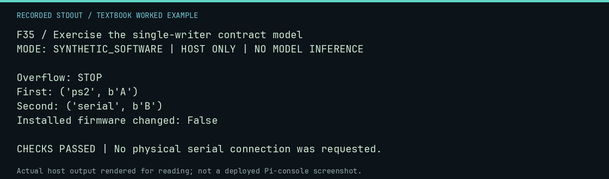

# F35 worked lab: Exercise the single-writer contract model

**Goal:** Exercise the single-writer contract model.

**Mode:** `SYNTHETIC_SOFTWARE`. This companion runs on the host; it does not
change the original packet's paper activity or authorize physical Replica work.

## Understand the example

This FIFO is a host model of a proposed firmware contract, not installed firmware. Two producers enqueue bytes and one service path preserves their order. Overflow must stop rather than silently drop data.

## Predict before running

Read the source below. Write down the expected printed values and the condition
that would make its checks fail. For a CPU trace, distinguish state before an
instruction from state after it. For a conceptual exercise, explain the rule
behind each classification rather than memorizing the printed label.

## Run it

From the checkout root with your environment active:

```bash
python -m tools.textbook run F35
```

The runner executes this [complete source](../examples/F35.py):

```python
from tools.firmware_behavior import QueueFullStop, SingleWriterQueue

queue = SingleWriterQueue(capacity=2)
queue.enqueue("ps2", b"A")
queue.enqueue("serial", b"B")
try:
    queue.enqueue("serial", b"C")
    raise AssertionError("overflow must stop")
except QueueFullStop:
    print("Overflow: STOP")
print("First:", queue.service_one())
print("Second:", queue.service_one())
assert queue.service_one() is None
print("Installed firmware changed: False")
```

## Recorded result

This output was actually executed and checked. The image is a readable render
of that stdout, not a screenshot of the deployed Pi console. A teaching fixture
or a host analogue is not independent historical or physical evidence.

```text
F35 / Exercise the single-writer contract model
MODE: SYNTHETIC_SOFTWARE | HOST ONLY | NO MODEL INFERENCE

Overflow: STOP
First: ('ps2', b'A')
Second: ('serial', b'B')
Installed firmware changed: False

CHECKS PASSED | No physical serial connection was requested.
```



[Raw output](../captures/F35.txt) · [Capture manifest](../captures/manifest.json)

## Change one thing

What additional work would be needed before claiming this fixes a physical fault?

<details>
<summary>Compare your reasoning with the worked answer</summary>

Qualified source identity, review, bounded instrumented procedures, actual measurements, and recovery evidence. This model supplies none of those physical observations.

</details>

## Check your understanding

Explain the result without reading the code aloud. Name one condition that the
example did not test. Keep your prediction, changed input, actual output, and
interpretation together in your lab notebook. Use the linked textbook chapter
and the original source records for the broader context and evidence limits.

[Textbook home](../README.md) · Previous: [F34: Link a proof capsule to explicit falsification work](F34.md) · Next: [F36: Connect a virtual echo program to a fixed-response bridge](F36.md)
