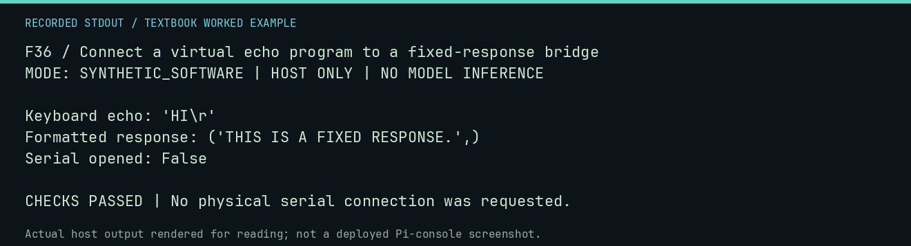

# F36 worked lab: Connect a virtual echo program to a fixed-response bridge

**Goal:** Connect a virtual echo program to a fixed-response bridge.

**Mode:** `SYNTHETIC_SOFTWARE`. This companion runs on the host; it does not
change the original packet's paper activity or authorize physical Replica work.

## Understand the example

The off-device bridge first executes the RAM input program, then formats a supplied response for a 40-column display. A fixed client separates bridge plumbing from real-model inference.

## Predict before running

Read the source below. Write down the expected printed values and the condition
that would make its checks fail. For a CPU trace, distinguish state before an
instruction from state after it. For a conceptual exercise, explain the rule
behind each classification rather than memorizing the printed label.

## Run it

From the checkout root with your environment active:

```bash
python -m tools.textbook run F36
```

The runner executes this [complete source](../examples/F36.py):

```python
from tools.textbook_support import ROOT
from tools.virtual_bridge import StaticModelClient, VirtualApple1Bridge

bridge = VirtualApple1Bridge(StaticModelClient("THIS IS A FIXED RESPONSE."))
r = bridge.run(ROOT / "software/ram-only/line-input-0300.hex", "HI\r")
print("Keyboard echo:", repr(r.keyboard_echo))
print("Formatted response:", r.response_lines)
print("Serial opened:", r.serial_opened)
assert r.keyboard_echo == "HI\r" and not r.serial_opened
```

## Recorded result

This output was actually executed and checked. The image is a readable render
of that stdout, not a screenshot of the deployed Pi console. A teaching fixture
or a host analogue is not independent historical or physical evidence.

```text
F36 / Connect a virtual echo program to a fixed-response bridge
MODE: SYNTHETIC_SOFTWARE | HOST ONLY | NO MODEL INFERENCE

Keyboard echo: 'HI\r'
Formatted response: ('THIS IS A FIXED RESPONSE.',)
Serial opened: False

CHECKS PASSED | No physical serial connection was requested.
```



[Raw output](../captures/F36.txt) · [Capture manifest](../captures/manifest.json)

## Change one thing

Which part changes when substituting a real local model?

<details>
<summary>Compare your reasoning with the worked answer</summary>

The provider call and its provenance/resource requirements. The deterministic echo and formatting contracts remain independently testable.

</details>

## Check your understanding

Explain the result without reading the code aloud. Name one condition that the
example did not test. Keep your prediction, changed input, actual output, and
interpretation together in your lab notebook. Use the linked textbook chapter
and the original source records for the broader context and evidence limits.

[Textbook home](../README.md) · Previous: [F35: Exercise the single-writer contract model](F35.md) · Next: [T01: Values and addresses](T01.md)
