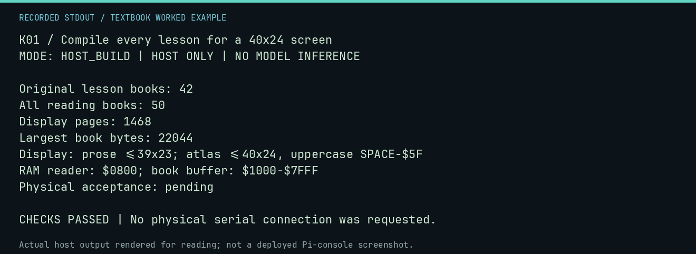

# K01 worked lab: Compile every lesson for a 40x24 screen

**Goal:** Check all card pages and RAM bounds.

**Mode:** `HOST_BUILD`. This companion runs on the host; it does not
change the original packet's paper activity or authorize physical Replica work.

## Understand the example

The compiler includes all 42 original packet readings, activities, text worksheets and answers. Model, feature, CPU, native-evidence and new lab guides provide host routes. The uppercase reading copy is explicitly separate from exact host commands.

## Predict before running

Read the source below. Write down the expected printed values and the condition
that would make its checks fail. For a CPU trace, distinguish state before an
instruction from state after it. For a conceptual exercise, explain the rule
behind each classification rather than memorizing the printed label.

## Run it

From the checkout root with your environment active:

```bash
python -m tools.textbook run K01
```

The runner executes this [complete source](../examples/K01.py):

```python
from tools.card_book import compile_books, decode_book

payloads, pages, manifest = compile_books()
assert len(pages) == 50
for record in manifest["books"]:
    decoded, answer = decode_book(payloads[record["name"]])
    assert decoded == pages[record["name"]]
    assert answer == record["answer_page"]
print("Original lesson books: 42")
print("All reading books:", len(pages))
print("Display pages:", sum(len(p) for p in pages.values()))
print("Largest book bytes:", max(len(payloads[name]) for name in pages))
print("Display: prose <=39x23; atlas <=40x24, uppercase SPACE-$5F")
print("RAM reader: $0800; book buffer: $1000-$7FFF")
print("Physical acceptance: pending")
```

## Recorded result

This output was actually executed and checked. The image is a readable render
of that stdout, not a screenshot of the deployed Pi console. A teaching fixture
or a host analogue is not independent historical or physical evidence.

```text
K01 / Compile every lesson for a 40x24 screen
MODE: HOST_BUILD | HOST ONLY | NO MODEL INFERENCE

Original lesson books: 42
All reading books: 50
Display pages: 1468
Largest book bytes: 22044
Display: prose <=39x23; atlas <=40x24, uppercase SPACE-$5F
RAM reader: $0800; book buffer: $1000-$7FFF
Physical acceptance: pending

CHECKS PASSED | No physical serial connection was requested.
```



[Raw output](../captures/K01.txt) · [Capture manifest](../captures/manifest.json)

## Change one thing

Why can a valid Markdown file still fail this card build?

<details>
<summary>Compare your reasoning with the worked answer</summary>

Display dimensions, unsupported characters, book size, filename and reader memory limits are additional constraints. A Markdown file is not a CFFA1 launcher.

</details>

## Check your understanding

Explain the result without reading the code aloud. Name one condition that the
example did not test. Keep your prediction, changed input, actual output, and
interpretation together in your lab notebook. Use the linked textbook chapter
and the original source records for the broader context and evidence limits.

[Textbook home](../README.md) · Previous: [U06: Generate a triangular pattern in BASIC](U06.md) · Next: [K02: Let real CFFA1 firmware build a virtual file](K02.md)
