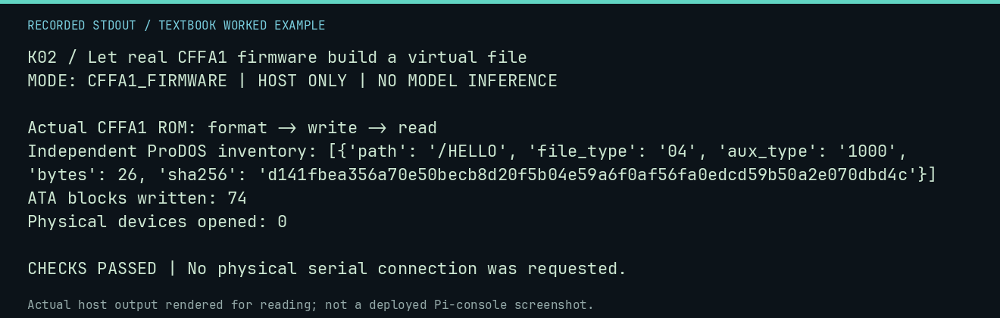

# K02 worked lab: Let real CFFA1 firmware build a virtual file

**Goal:** Inspect a ProDOS file independently after firmware writes it.

**Mode:** `CFFA1_FIRMWARE`. This companion runs on the host; it does not
change the original packet's paper activity or authorize physical Replica work.

## Understand the example

The preserved CFFA1 ROM runs on an NMOS 6502 with modeled ATA registers. It formats only a new in-memory test card, writes a file and reads it back. A separate Python ProDOS reader checks the result.

## Predict before running

Read the source below. Write down the expected printed values and the condition
that would make its checks fail. For a CPU trace, distinguish state before an
instruction from state after it. For a conceptual exercise, explain the rule
behind each classification rather than memorizing the printed label.

## Run it

From the checkout root with your environment active:

```bash
python -m tools.textbook run K02
```

The runner executes this [complete source](../examples/K02.py):

```python
from tools.cffa1_model import blank_virtual_card
from tools.prodos import ProdosImage

machine = blank_virtual_card()
data = b"HELLO FROM A VIRTUAL CARD" + bytes([13])
machine.write_file("HELLO", data, file_type=4)
assert machine.read_file("HELLO") == data
image = ProdosImage(machine.memory.materialize())
assert image.read("/HELLO") == data
print("Actual CFFA1 ROM: format -> write -> read")
print("Independent ProDOS inventory:", image.inventory())
print("ATA blocks written:", machine.memory.writes)
print("Physical devices opened: 0")
```

## Recorded result

This output was actually executed and checked. The image is a readable render
of that stdout, not a screenshot of the deployed Pi console. A teaching fixture
or a host analogue is not independent historical or physical evidence.

```text
K02 / Let real CFFA1 firmware build a virtual file
MODE: CFFA1_FIRMWARE | HOST ONLY | NO MODEL INFERENCE

Actual CFFA1 ROM: format -> write -> read
Independent ProDOS inventory: [{'path': '/HELLO', 'file_type': '04', 'aux_type': '1000', 'bytes': 26, 'sha256': 'd141fbea356a70e50becb8d20f5b04e59a6f0af56fa0edcd59b50a2e070dbd4c'}]
ATA blocks written: 74
Physical devices opened: 0

CHECKS PASSED | No physical serial connection was requested.
```



[Raw output](../captures/K02.txt) · [Capture manifest](../captures/manifest.json)

## Change one thing

Does this prove the installed CFFA1 or physical card works?

<details>
<summary>Compare your reasoning with the worked answer</summary>

No. It checks this identified firmware against the declared ATA model. Installed identity, bus behavior, timing and physical media remain hardware acceptance work.

</details>

## Check your understanding

Explain the result without reading the code aloud. Name one condition that the
example did not test. Keep your prediction, changed input, actual output, and
interpretation together in your lab notebook. Use the linked textbook chapter
and the original source records for the broader context and evidence limits.

[Textbook home](../README.md) · Previous: [K01: Compile every lesson for a 40x24 screen](K01.md) · Next: [K03: Navigate the RAM card reader](K03.md)
