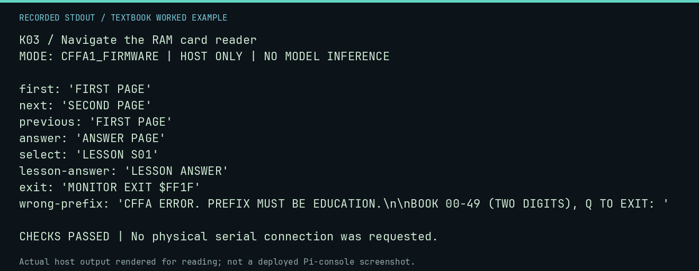

# K03 worked lab: Navigate the RAM card reader

**Goal:** Run actual pager instructions and verify visible text.

**Mode:** `CFFA1_FIRMWARE`. This companion runs on the host; it does not
change the original packet's paper activity or authorize physical Replica work.

## Understand the example

The RAM reader uses the real CFFA1 API and a modeled keyboard/display. The rehearsal checks first page, next, previous, answer jump, book selection and Monitor exit. These are CPU results, not physical screen photographs.

## Predict before running

Read the source below. Write down the expected printed values and the condition
that would make its checks fail. For a CPU trace, distinguish state before an
instruction from state after it. For a conceptual exercise, explain the rule
behind each classification rather than memorizing the printed label.

## Run it

From the checkout root with your environment active:

```bash
python -m tools.textbook run K03
```

The runner executes this [complete source](../examples/K03.py):

```python
from tools.card_image import rehearse_reader

result = rehearse_reader()
for action, text in result.items():
    print(action + ":", repr(text))
```

## Recorded result

This output was actually executed and checked. The image is a readable render
of that stdout, not a screenshot of the deployed Pi console. A teaching fixture
or a host analogue is not independent historical or physical evidence.

```text
K03 / Navigate the RAM card reader
MODE: CFFA1_FIRMWARE | HOST ONLY | NO MODEL INFERENCE

first: 'FIRST PAGE'
next: 'SECOND PAGE'
previous: 'FIRST PAGE'
answer: 'ANSWER PAGE'
select: 'LESSON S01'
lesson-answer: 'LESSON ANSWER'
exit: 'MONITOR EXIT $FF1F'
wrong-prefix: 'CFFA ERROR. PREFIX MUST BE EDUCATION.\n\nBOOK 00-49 (TWO DIGITS), Q TO EXIT: '

CHECKS PASSED | No physical serial connection was requested.
```



[Raw output](../captures/K03.txt) · [Capture manifest](../captures/manifest.json)

## Change one thing

What happens if the reader is launched with the wrong prefix?

<details>
<summary>Compare your reasoning with the worked answer</summary>

It shows a CFFA error and offers another book selection. Choose EDUCATION in the CFFA menu before loading the reader.

</details>

## Check your understanding

Explain the result without reading the code aloud. Name one condition that the
example did not test. Keep your prediction, changed input, actual output, and
interpretation together in your lab notebook. Use the linked textbook chapter
and the original source records for the broader context and evidence limits.

[Textbook home](../README.md) · Previous: [K02: Let real CFFA1 firmware build a virtual file](K02.md) · Next: [K04: Save and restore BASIC in CFFA1 format](K04.md)
