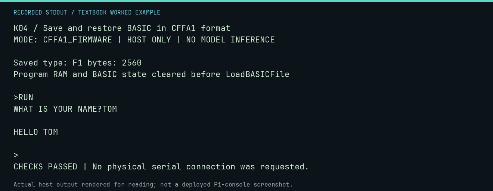

# K04 worked lab: Save and restore BASIC in CFFA1 format

**Goal:** Generate a real BA1 file and execute the restored program.

**Mode:** `CFFA1_FIRMWARE`. This companion runs on the host; it does not
change the original packet's paper activity or authorize physical Replica work.

## Understand the example

The interpreter tokenizes the authored program. CFFA1 SaveBASICFile emits its A1 header and $F1 file; LoadBASICFile restores state into cleared RAM. A BASIC warm start then executes the restored program.

## Predict before running

Read the source below. Write down the expected printed values and the condition
that would make its checks fail. For a CPU trace, distinguish state before an
instruction from state after it. For a conceptual exercise, explain the rule
behind each classification rather than memorizing the printed label.

## Run it

From the checkout root with your environment active:

```bash
python -m tools.textbook run K04
```

The runner executes this [complete source](../examples/K04.py):

```python
from tools.apple1_basic import ROM, resume_session
from tools.cffa1_model import blank_virtual_card
from tools.prodos import ProdosImage
from tools.textbook_support import ROOT

machine = blank_virtual_card()
machine.save_basic("HELLO", (ROOT / "software/basic/HELLO.bas").read_text())
image = ProdosImage(machine.memory.materialize())
entry = image.entries["/HELLO"]
assert entry.file_type == 0xF1
assert image.read("/HELLO").startswith(b"A1" + bytes([0]))
machine.memory[0x4A:0x100] = [0] * 182
machine.memory[0x800:0x1000] = [0] * 2048
machine.memory[0xE000:0xF000] = ROM.read_bytes()
machine.api(0x26, name="HELLO")
result = resume_session(machine.memory, ["RUN", "TOM"])
print("Saved type:", f"{entry.file_type:02X}", "bytes:", entry.size)
print("Program RAM and BASIC state cleared before LoadBASICFile")
print(result.transcript, end="")
assert "HELLO TOM" in result.transcript and "***" not in result.transcript
assert result.stop == "waiting-for-input"
```

## Recorded result

This output was actually executed and checked. The image is a readable render
of that stdout, not a screenshot of the deployed Pi console. A teaching fixture
or a host analogue is not independent historical or physical evidence.

```text
K04 / Save and restore BASIC in CFFA1 format
MODE: CFFA1_FIRMWARE | HOST ONLY | NO MODEL INFERENCE

Saved type: F1 bytes: 2560
Program RAM and BASIC state cleared before LoadBASICFile

>RUN
WHAT IS YOUR NAME?TOM

HELLO TOM

>
CHECKS PASSED | No physical serial connection was requested.
```



[Raw output](../captures/K04.txt) · [Capture manifest](../captures/manifest.json)

## Change one thing

Why would renaming a .bas text file to a BASIC filename be insufficient?

<details>
<summary>Compare your reasoning with the worked answer</summary>

CFFA1 BA1 stores interpreter state and tokenized memory, including a versioned header. Plain source text is a different format. Use the interpreter and save API rather than a filename trick.

</details>

## Check your understanding

Explain the result without reading the code aloud. Name one condition that the
example did not test. Keep your prediction, changed input, actual output, and
interpretation together in your lab notebook. Use the linked textbook chapter
and the original source records for the broader context and evidence limits.

[Textbook home](../README.md) · Previous: [K03: Navigate the RAM card reader](K03.md)
