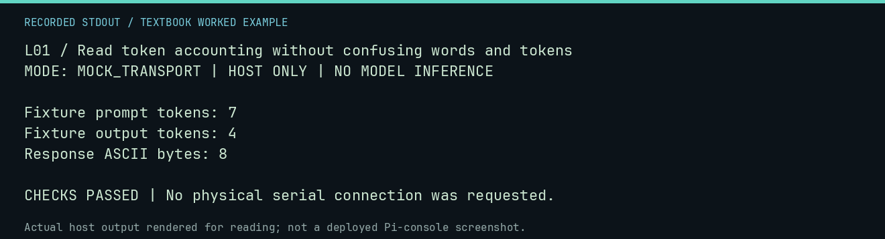

# L01 worked lab: Read token accounting without confusing words and tokens

**Goal:** Read token accounting without confusing words and tokens.

**Mode:** `MOCK_TRANSPORT`. This companion runs on the host; it does not
change the original packet's paper activity or authorize physical Replica work.

## Understand the example

Tokens belong to a model tokenizer, not the Apple-1 byte encoding. The mock API reports token counters; the adapter retains them rather than counting words. The numbers below are explicitly supplied fixture metadata, not measured inference.

## Predict before running

Read the source below. Write down the expected printed values and the condition
that would make its checks fail. For a CPU trace, distinguish state before an
instruction from state after it. For a conceptual exercise, explain the rule
behind each classification rather than memorizing the printed label.

## Run it

From the checkout root with your environment active:

```bash
python -m tools.textbook run L01
```

The runner executes this [complete source](../examples/L01.py):

```python
import json

from neural1.models import OllamaHttpProvider


def opener(request, timeout):
    return json.dumps({"response": "0300: 2A", "prompt_eval_count": 7, "eval_count": 4}).encode()


r = OllamaHttpProvider("token-fixture", opener=opener).generate("Inspect byte", agent_id="A", seed=1)
print("Fixture prompt tokens:", r.prompt_tokens)
print("Fixture output tokens:", r.completion_tokens)
print("Response ASCII bytes:", len(r.text.encode("ascii")))
assert r.prompt_tokens == 7 and r.completion_tokens == 4
```

## Recorded result

This output was actually executed and checked. The image is a readable render
of that stdout, not a screenshot of the deployed Pi console. A teaching fixture
or a host analogue is not independent historical or physical evidence.

```text
L01 / Read token accounting without confusing words and tokens
MODE: MOCK_TRANSPORT | HOST ONLY | NO MODEL INFERENCE

Fixture prompt tokens: 7
Fixture output tokens: 4
Response ASCII bytes: 8

CHECKS PASSED | No physical serial connection was requested.
```



[Raw output](../captures/L01.txt) · [Capture manifest](../captures/manifest.json)

## Change one thing

Can you infer token count from the number of ASCII bytes?

<details>
<summary>Compare your reasoning with the worked answer</summary>

No. The tokenizer determines segmentation. Preserve the provider-reported counters and model identity.

</details>

## Check your understanding

Explain the result without reading the code aloud. Name one condition that the
example did not test. Keep your prediction, changed input, actual output, and
interpretation together in your lab notebook. Use the linked textbook chapter
and the original source records for the broader context and evidence limits.

[Textbook home](../README.md) · Previous: [F26: Inspect research staging without promoting it](F26.md) · Next: [L02: Estimate weight storage without promising total RAM use](L02.md)
