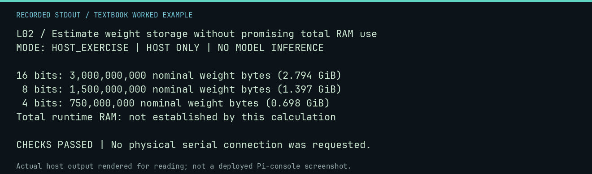

# L02 worked lab: Estimate weight storage without promising total RAM use

**Goal:** Estimate weight storage without promising total RAM use.

**Mode:** `HOST_EXERCISE`. This companion runs on the host; it does not
change the original packet's paper activity or authorize physical Replica work.

## Understand the example

Parameter count multiplied by nominal bits per weight gives a lower-level storage estimate. It excludes metadata, quantization scales, runtime allocations, and context/KV cache. It is not a memory-fit benchmark or a model recommendation.

## Predict before running

Read the source below. Write down the expected printed values and the condition
that would make its checks fail. For a CPU trace, distinguish state before an
instruction from state after it. For a conceptual exercise, explain the rule
behind each classification rather than memorizing the printed label.

## Run it

From the checkout root with your environment active:

```bash
python -m tools.textbook run L02
```

The runner executes this [complete source](../examples/L02.py):

```python
parameters = 1_500_000_000
for bits in (16, 8, 4):
    nominal = parameters * bits // 8
    print(f"{bits:2d} bits: {nominal:,} nominal weight bytes ({nominal / 2**30:.3f} GiB)")
assert parameters * 4 // 8 == 750_000_000
print("Total runtime RAM: not established by this calculation")
```

## Recorded result

This output was actually executed and checked. The image is a readable render
of that stdout, not a screenshot of the deployed Pi console. A teaching fixture
or a host analogue is not independent historical or physical evidence.

```text
L02 / Estimate weight storage without promising total RAM use
MODE: HOST_EXERCISE | HOST ONLY | NO MODEL INFERENCE

16 bits: 3,000,000,000 nominal weight bytes (2.794 GiB)
 8 bits: 1,500,000,000 nominal weight bytes (1.397 GiB)
 4 bits: 750,000,000 nominal weight bytes (0.698 GiB)
Total runtime RAM: not established by this calculation

CHECKS PASSED | No physical serial connection was requested.
```



[Raw output](../captures/L02.txt) · [Capture manifest](../captures/manifest.json)

## Change one thing

Why can a nominal 750 MB weight estimate exceed 750 MB in actual memory?

<details>
<summary>Compare your reasoning with the worked answer</summary>

Scales and metadata, activation/runtime buffers, allocator overhead, and the context cache all add storage.

</details>

## Check your understanding

Explain the result without reading the code aloud. Name one condition that the
example did not test. Keep your prediction, changed input, actual output, and
interpretation together in your lab notebook. Use the linked textbook chapter
and the original source records for the broader context and evidence limits.

[Textbook home](../README.md) · Previous: [L01: Read token accounting without confusing words and tokens](L01.md) · Next: [L03: Separate model context from persistent machine memory](L03.md)
