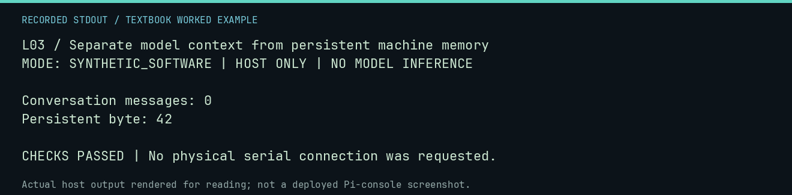

# L03 worked lab: Separate model context from persistent machine memory

**Goal:** Separate model context from persistent machine memory.

**Mode:** `SYNTHETIC_SOFTWARE`. This companion runs on the host; it does not
change the original packet's paper activity or authorize physical Replica work.

## Understand the example

A conversation context and a byte in virtual RAM are different stores. This lab clears an authored Python context list while preserving a world snapshot. A later real-model experiment would need to show what the model can recover from RAM through its permitted interface.

## Predict before running

Read the source below. Write down the expected printed values and the condition
that would make its checks fail. For a CPU trace, distinguish state before an
instruction from state after it. For a conceptual exercise, explain the rule
behind each classification rather than memorizing the printed label.

## Run it

From the checkout root with your environment active:

```bash
python -m tools.textbook run L03
```

The runner executes this [complete source](../examples/L03.py):

```python
from neural1.world import VirtualApple1World

world = VirtualApple1World()
context = ["remember the answer is 42"]
world.host_write(0x400, b"\x2a")
context.clear()
print("Conversation messages:", len(context))
print("Persistent byte:", world.host_read(0x400)[0])
assert not context and world.host_read(0x400)[0] == 42
```

## Recorded result

This output was actually executed and checked. The image is a readable render
of that stdout, not a screenshot of the deployed Pi console. A teaching fixture
or a host analogue is not independent historical or physical evidence.

```text
L03 / Separate model context from persistent machine memory
MODE: SYNTHETIC_SOFTWARE | HOST ONLY | NO MODEL INFERENCE

Conversation messages: 0
Persistent byte: 42

CHECKS PASSED | No physical serial connection was requested.
```



[Raw output](../captures/L03.txt) · [Capture manifest](../captures/manifest.json)

## Change one thing

Does the retained byte guarantee the next model will interpret it correctly?

<details>
<summary>Compare your reasoning with the worked answer</summary>

No. The model still needs a usable convention and must discover or follow it through the allowed observations.

</details>

## Check your understanding

Explain the result without reading the code aloud. Name one condition that the
example did not test. Keep your prediction, changed input, actual output, and
interpretation together in your lab notebook. Use the linked textbook chapter
and the original source records for the broader context and evidence limits.

[Textbook home](../README.md) · Previous: [L02: Estimate weight storage without promising total RAM use](L02.md) · Next: [L04: Treat a model response as a proposal, not an instruction to the host](L04.md)
