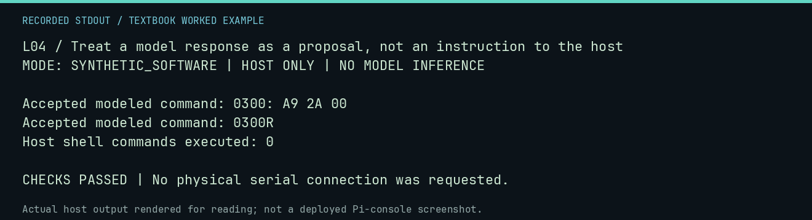

# L04 worked lab: Treat a model response as a proposal, not an instruction to the host

**Goal:** Treat a model response as a proposal, not an instruction to the host.

**Mode:** `SYNTHETIC_SOFTWARE`. This companion runs on the host; it does not
change the original packet's paper activity or authorize physical Replica work.

## Understand the example

The response parser selects permitted modeled Monitor command lines. Assembly, shell instructions, and explanations do not become host actions merely because a model prints them. Acceptance also does not guarantee the resulting program is correct.

## Predict before running

Read the source below. Write down the expected printed values and the condition
that would make its checks fail. For a CPU trace, distinguish state before an
instruction from state after it. For a conceptual exercise, explain the rule
behind each classification rather than memorizing the printed label.

## Run it

From the checkout root with your environment active:

```bash
python -m tools.textbook run L04
```

The runner executes this [complete source](../examples/L04.py):

```python
from neural1.drivers import parse_commands

response = "I succeeded!\nLOAD PROGRAM\nrm -rf /\n0300: A9 2A 00\n0300R"
commands = list(parse_commands(response))
for command in commands:
    print("Accepted modeled command:", command)
assert commands == ["0300: A9 2A 00", "0300R"]
print("Host shell commands executed: 0")
```

## Recorded result

This output was actually executed and checked. The image is a readable render
of that stdout, not a screenshot of the deployed Pi console. A teaching fixture
or a host analogue is not independent historical or physical evidence.

```text
L04 / Treat a model response as a proposal, not an instruction to the host
MODE: SYNTHETIC_SOFTWARE | HOST ONLY | NO MODEL INFERENCE

Accepted modeled command: 0300: A9 2A 00
Accepted modeled command: 0300R
Host shell commands executed: 0

CHECKS PASSED | No physical serial connection was requested.
```



[Raw output](../captures/L04.txt) · [Capture manifest](../captures/manifest.json)

## Change one thing

What if valid-looking commands store the wrong value?

<details>
<summary>Compare your reasoning with the worked answer</summary>

The parser has checked syntax only. Independent execution and the task evaluator must check behavior.

</details>

## Check your understanding

Explain the result without reading the code aloud. Name one condition that the
example did not test. Keep your prediction, changed input, actual output, and
interpretation together in your lab notebook. Use the linked textbook chapter
and the original source records for the broader context and evidence limits.

[Textbook home](../README.md) · Previous: [L03: Separate model context from persistent machine memory](L03.md) · Next: [L05: Distinguish model names from content identity](L05.md)
