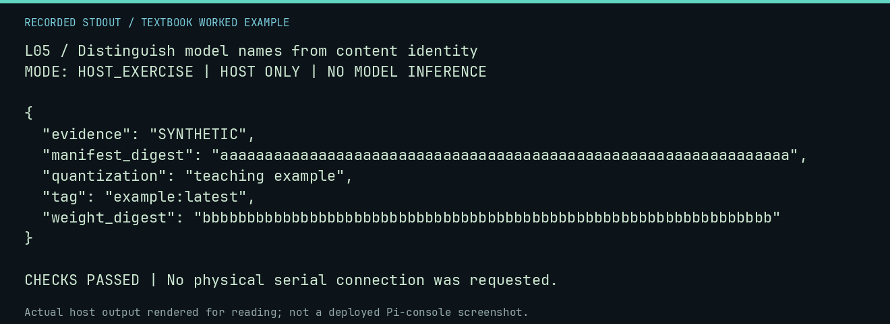

# L05 worked lab: Distinguish model names from content identity

**Goal:** Distinguish model names from content identity.

**Mode:** `HOST_EXERCISE`. This companion runs on the host; it does not
change the original packet's paper activity or authorize physical Replica work.

## Understand the example

A friendly tag can name different content over time. A manifest digest and a GGUF weight digest identify different artifacts. This authored metadata example teaches which identity each field describes; it does not qualify a real model.

## Predict before running

Read the source below. Write down the expected printed values and the condition
that would make its checks fail. For a CPU trace, distinguish state before an
instruction from state after it. For a conceptual exercise, explain the rule
behind each classification rather than memorizing the printed label.

## Run it

From the checkout root with your environment active:

```bash
python -m tools.textbook run L05
```

The runner executes this [complete source](../examples/L05.py):

```python
from tools.textbook_support import emit

record = {
    "tag": "example:latest",
    "manifest_digest": "a" * 64,
    "weight_digest": "b" * 64,
    "quantization": "teaching example",
    "evidence": "SYNTHETIC",
}
emit(record)
assert record["manifest_digest"] != record["weight_digest"]
```

## Recorded result

This output was actually executed and checked. The image is a readable render
of that stdout, not a screenshot of the deployed Pi console. A teaching fixture
or a host analogue is not independent historical or physical evidence.

```text
L05 / Distinguish model names from content identity
MODE: HOST_EXERCISE | HOST ONLY | NO MODEL INFERENCE

{
  "evidence": "SYNTHETIC",
  "manifest_digest": "aaaaaaaaaaaaaaaaaaaaaaaaaaaaaaaaaaaaaaaaaaaaaaaaaaaaaaaaaaaaaaaa",
  "quantization": "teaching example",
  "tag": "example:latest",
  "weight_digest": "bbbbbbbbbbbbbbbbbbbbbbbbbbbbbbbbbbbbbbbbbbbbbbbbbbbbbbbbbbbbbbbb"
}

CHECKS PASSED | No physical serial connection was requested.
```



[Raw output](../captures/L05.txt) · [Capture manifest](../captures/manifest.json)

## Change one thing

Which digest should you substitute for a missing license?

<details>
<summary>Compare your reasoning with the worked answer</summary>

Neither. Content identity and permission/provenance are different registry fields.

</details>

## Check your understanding

Explain the result without reading the code aloud. Name one condition that the
example did not test. Keep your prediction, changed input, actual output, and
interpretation together in your lab notebook. Use the linked textbook chapter
and the original source records for the broader context and evidence limits.

[Textbook home](../README.md) · Previous: [L04: Treat a model response as a proposal, not an instruction to the host](L04.md) · Next: [L06: Interpret latency from a retained native run](L06.md)
