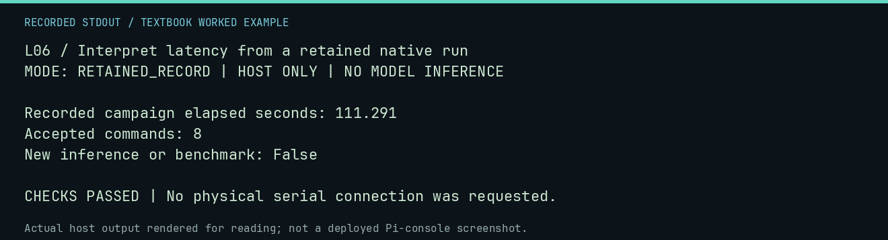

# L06 worked lab: Interpret latency from a retained native run

**Goal:** Interpret latency from a retained native run.

**Mode:** `RETAINED_RECORD`. This companion runs on the host; it does not
change the original packet's paper activity or authorize physical Replica work.

## Understand the example

Elapsed campaign time and model request latency are not interchangeable with tokens per second. This reads a retained native run and reports only its recorded elapsed time and accepted-command count. It performs no new benchmark.

## Predict before running

Read the source below. Write down the expected printed values and the condition
that would make its checks fail. For a CPU trace, distinguish state before an
instruction from state after it. For a conceptual exercise, explain the rule
behind each classification rather than memorizing the printed label.

## Run it

From the checkout root with your environment active:

```bash
python -m tools.textbook run L06
```

The runner executes this [complete source](../examples/L06.py):

```python
import json

from tools.textbook_support import ROOT

r = json.loads((ROOT / "docs/neural1/operations/evidence/pi-closeout-2026-09-10/post-boot-run.json").read_text())
print("Recorded campaign elapsed seconds:", round(r["elapsed_seconds"], 3))
print("Accepted commands:", r["family_result"]["accepted_transactions"])
print("New inference or benchmark: False")
assert r["elapsed_seconds"] > 0
```

## Recorded result

This output was actually executed and checked. The image is a readable render
of that stdout, not a screenshot of the deployed Pi console. A teaching fixture
or a host analogue is not independent historical or physical evidence.

```text
L06 / Interpret latency from a retained native run
MODE: RETAINED_RECORD | HOST ONLY | NO MODEL INFERENCE

Recorded campaign elapsed seconds: 111.291
Accepted commands: 8
New inference or benchmark: False

CHECKS PASSED | No physical serial connection was requested.
```



[Raw output](../captures/L06.txt) · [Capture manifest](../captures/manifest.json)

## Change one thing

Why not divide eight commands by elapsed time and call it model tokens per second?

<details>
<summary>Compare your reasoning with the worked answer</summary>

Commands and tokens are different units, and elapsed time includes additional work. Use the relevant provider counters and durations.

</details>

## Check your understanding

Explain the result without reading the code aloud. Name one condition that the
example did not test. Keep your prediction, changed input, actual output, and
interpretation together in your lab notebook. Use the linked textbook chapter
and the original source records for the broader context and evidence limits.

[Textbook home](../README.md) · Previous: [L05: Distinguish model names from content identity](L05.md) · Next: [L07: Bound a research matrix before launching it](L07.md)
