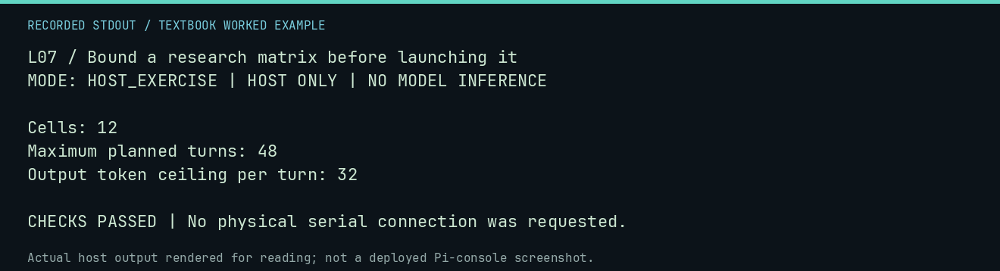

# L07 worked lab: Bound a research matrix before launching it

**Goal:** Bound a research matrix before launching it.

**Mode:** `HOST_EXERCISE`. This companion runs on the host; it does not
change the original packet's paper activity or authorize physical Replica work.

## Understand the example

Cartesian products multiply quickly: models times experiments times seeds, with additional generations and agents inside each cell. A bounded plan makes the cost and stopping criteria explicit before inference.

## Predict before running

Read the source below. Write down the expected printed values and the condition
that would make its checks fail. For a CPU trace, distinguish state before an
instruction from state after it. For a conceptual exercise, explain the rule
behind each classification rather than memorizing the printed label.

## Run it

From the checkout root with your environment active:

```bash
python -m tools.textbook run L07
```

The runner executes this [complete source](../examples/L07.py):

```python
from neural1.campaign import CampaignSpec

spec = CampaignSpec.create(
    experiments=["4k-mind", "ram-republic"],
    model_ids=["fixture-a", "fixture-b"],
    seeds=[1, 2, 3],
    generations=2,
    agents_per_cell=2,
    ram_budget=1024,
    max_tokens=32,
    generation_settings={},
    matched_control="declared fixture",
    wall_clock_limit_seconds=20,
)
print("Cells:", len(spec.cells))
print("Maximum planned turns:", len(spec.cells) * spec.generations * spec.agents_per_cell)
print("Output token ceiling per turn:", spec.max_tokens)
assert len(spec.cells) == 12
```

## Recorded result

This output was actually executed and checked. The image is a readable render
of that stdout, not a screenshot of the deployed Pi console. A teaching fixture
or a host analogue is not independent historical or physical evidence.

```text
L07 / Bound a research matrix before launching it
MODE: HOST_EXERCISE | HOST ONLY | NO MODEL INFERENCE

Cells: 12
Maximum planned turns: 48
Output token ceiling per turn: 32

CHECKS PASSED | No physical serial connection was requested.
```



[Raw output](../captures/L07.txt) · [Capture manifest](../captures/manifest.json)

## Change one thing

Why is a per-cell deadline different from an overall resource guarantee?

<details>
<summary>Compare your reasoning with the worked answer</summary>

Concurrency, runtime overhead, cache state, thermal behavior, and external failures still need explicit supervision.

</details>

## Check your understanding

Explain the result without reading the code aloud. Name one condition that the
example did not test. Keep your prediction, changed input, actual output, and
interpretation together in your lab notebook. Use the linked textbook chapter
and the original source records for the broader context and evidence limits.

[Textbook home](../README.md) · Previous: [L06: Interpret latency from a retained native run](L06.md) · Next: [L08: Use negative controls before widening a claim](L08.md)
