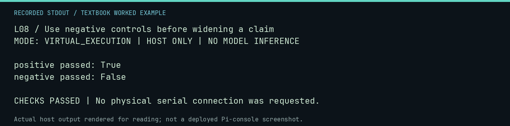

# L08 worked lab: Use negative controls before widening a claim

**Goal:** Use negative controls before widening a claim.

**Mode:** `VIRTUAL_EXECUTION`. This companion runs on the host; it does not
change the original packet's paper activity or authorize physical Replica work.

## Understand the example

A useful evaluator must distinguish a candidate that meets the task from one that does not. This lesson uses the exact-256 evaluator with a positive and a negative authored fixture, so "the evaluator ran" cannot substitute for "the task passed."

## Predict before running

Read the source below. Write down the expected printed values and the condition
that would make its checks fail. For a CPU trace, distinguish state before an
instruction from state after it. For a conceptual exercise, explain the rule
behind each classification rather than memorizing the printed label.

## Run it

From the checkout root with your environment active:

```bash
python -m tools.textbook run L08
```

The runner executes this [complete source](../examples/L08.py):

```python
from neural1.family_runner import evaluate_family
from neural1.world import VirtualApple1World, WozMonSession

for label, image, expected in [("positive", bytes.fromhex("A9 41 20 EF FF 4C 1F FF") + bytes(248), True), ("negative", bytes(256), False)]:
    w = VirtualApple1World()
    commands = [f"{0x200 + i:04X}: " + image[i : i + 16].hex(" ").upper() for i in range(0, 256, 16)] + ["0200R"]
    records = [
        {
            "agent_id": "fixture",
            "generation": 0,
            "response": "\n".join(commands),
            "outputs": [WozMonSession(w).transact(c) for c in commands],
        }
    ]
    r = evaluate_family("256-byte-universe", w, records)
    print(label, "passed:", r["passed"])
    assert r["passed"] is expected
```

## Recorded result

This output was actually executed and checked. The image is a readable render
of that stdout, not a screenshot of the deployed Pi console. A teaching fixture
or a host analogue is not independent historical or physical evidence.

```text
L08 / Use negative controls before widening a claim
MODE: VIRTUAL_EXECUTION | HOST ONLY | NO MODEL INFERENCE

positive passed: True
negative passed: False

CHECKS PASSED | No physical serial connection was requested.
```



[Raw output](../captures/L08.txt) · [Capture manifest](../captures/manifest.json)

## Change one thing

Does passing a positive control establish a general replacement Monitor?

<details>
<summary>Compare your reasoning with the worked answer</summary>

No. It establishes that specific output/return task under its explicit constraints.

</details>

## Check your understanding

Explain the result without reading the code aloud. Name one condition that the
example did not test. Keep your prediction, changed input, actual output, and
interpretation together in your lab notebook. Use the linked textbook chapter
and the original source records for the broader context and evidence limits.

[Textbook home](../README.md) · Previous: [L07: Bound a research matrix before launching it](L07.md) · Next: [F27: Use deterministic mutation and selection policies](F27.md)
