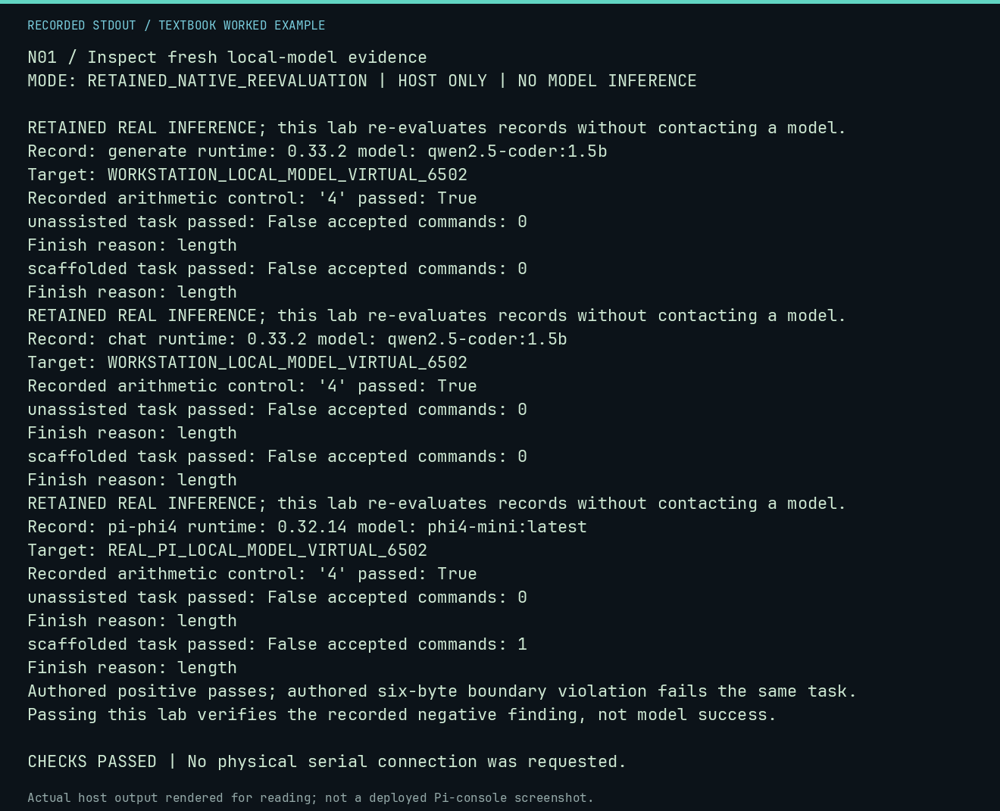

# N01 worked lab: Inspect fresh local-model evidence

**Goal:** Re-evaluate actual generated proposals and compare controls.

**Mode:** `RETAINED_NATIVE_REEVALUATION`. This companion runs on the host; it does not
change the original packet's paper activity or authorize physical Replica work.

## Understand the example

The retained workstation runs used identified cached Qwen weights and Ollama 0.33.2 through both generate and chat APIs. Each arithmetic control returned 4, while the four bounded 6502 proposals failed the declared task. This lab verifies hashes and independently re-executes retained proposal text; it requests no new inference. An authored positive and boundary-violating negative check the same evaluator. Passing the lab confirms reproduction of the recorded finding, not a successful model-generated program. The Pi record adds actual Phi-4 inference on an identified Raspberry Pi 5; its two proposals also fail this strict task. This is not a comparison benchmark because model, runtime and host differ.

## Predict before running

Read the source below. Write down the expected printed values and the condition
that would make its checks fail. For a CPU trace, distinguish state before an
instruction from state after it. For a conceptual exercise, explain the rule
behind each classification rather than memorizing the printed label.

## Run it

From the checkout root with your environment active:

```bash
python -m tools.textbook run N01
```

The runner executes this [complete source](../examples/N01.py):

```python
import json

from tools.textbook_native import evaluate, verify
from tools.textbook_support import ROOT

for name in ("generate", "chat", "pi-phi4"):
    directory = ROOT / "docs/textbook/native/evidence" / name
    receipt = verify(directory)
    print("RETAINED REAL INFERENCE; this lab re-evaluates records without contacting a model.")
    print("Record:", name, "runtime:", receipt["runtime"]["version"], "model:", receipt["model"]["name"])
    print("Target:", receipt["target"])
    control = json.loads((directory / "health-control.json").read_text())
    print("Recorded arithmetic control:", repr(control["generation"]["text"]), "passed:", control["passed"])
    for label in receipt["trials"]:
        trial = json.loads((directory / f"{label}.json").read_text())
        result = trial["evaluation"]
        print(label, "task passed:", result["passed"], "accepted commands:", len(result["commands"]))
        print("Finish reason:", trial["generation"]["provider_metadata"]["done_reason"])
        assert result["passed"] is False
positive = "0300: A0 00 A9 2A 99 00 04 C8 C0 05 D0 F8 4C 1F FF\n0300R"
assert evaluate(positive)["passed"]
assert not evaluate(positive.replace("C0 05", "C0 06"))["passed"]
print("Authored positive passes; authored six-byte boundary violation fails the same task.")
print("Passing this lab verifies the recorded negative finding, not model success.")
```

## Recorded result

This output was actually executed and checked. The image is a readable render
of that stdout, not a screenshot of the deployed Pi console. A teaching fixture
or a host analogue is not independent historical or physical evidence.

```text
N01 / Inspect fresh local-model evidence
MODE: RETAINED_NATIVE_REEVALUATION | HOST ONLY | NO MODEL INFERENCE

RETAINED REAL INFERENCE; this lab re-evaluates records without contacting a model.
Record: generate runtime: 0.33.2 model: qwen2.5-coder:1.5b
Target: WORKSTATION_LOCAL_MODEL_VIRTUAL_6502
Recorded arithmetic control: '4' passed: True
unassisted task passed: False accepted commands: 0
Finish reason: length
scaffolded task passed: False accepted commands: 0
Finish reason: length
RETAINED REAL INFERENCE; this lab re-evaluates records without contacting a model.
Record: chat runtime: 0.33.2 model: qwen2.5-coder:1.5b
Target: WORKSTATION_LOCAL_MODEL_VIRTUAL_6502
Recorded arithmetic control: '4' passed: True
unassisted task passed: False accepted commands: 0
Finish reason: length
scaffolded task passed: False accepted commands: 0
Finish reason: length
RETAINED REAL INFERENCE; this lab re-evaluates records without contacting a model.
Record: pi-phi4 runtime: 0.32.14 model: phi4-mini:latest
Target: REAL_PI_LOCAL_MODEL_VIRTUAL_6502
Recorded arithmetic control: '4' passed: True
unassisted task passed: False accepted commands: 0
Finish reason: length
scaffolded task passed: False accepted commands: 1
Finish reason: length
Authored positive passes; authored six-byte boundary violation fails the same task.
Passing this lab verifies the recorded negative finding, not model success.

CHECKS PASSED | No physical serial connection was requested.
```



[Raw output](../captures/N01.txt) · [Capture manifest](../captures/manifest.json)

## Change one thing

Does four failed proposals prove that Qwen cannot write any 6502 program?

<details>
<summary>Compare your reasoning with the worked answer</summary>

No. They describe these two prompts, seed, weights, runtime and output/context bounds. They are not a benchmark, and neither the arithmetic control nor an authored positive control establishes general model competence.

</details>

## Check your understanding

Explain the result without reading the code aloud. Name one condition that the
example did not test. Keep your prediction, changed input, actual output, and
interpretation together in your lab notebook. Use the linked textbook chapter
and the original source records for the broader context and evidence limits.

[Textbook home](../README.md) · Previous: [T12: Reset, BRK and interrupt return](T12.md) · Next: [N02: Read the installed Pi tutor and trace](N02.md)
