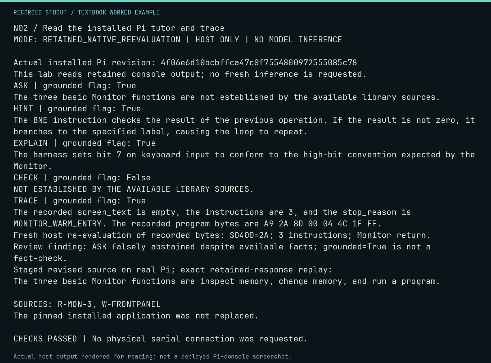

# N02 worked lab: Read the installed Pi tutor and trace

**Goal:** Separate generated tutoring from deterministic native execution.

**Mode:** `RETAINED_NATIVE_REEVALUATION`. This companion runs on the host; it does not
change the original packet's paper activity or authorize physical Replica work.

## Understand the example

The retained console calls ran on the commissioned Pi and its pinned September application. HINT and EXPLAIN supplied useful statements; CHECK abstained and ASK incorrectly declined an available fact. TRACE retained actual program bytes and a three-instruction Monitor return. This lab verifies those records and independently executes the recorded bytes on the host. The runtime grounded flag describes its support path; it does not certify factual accuracy. A follow-up with the revised source on the real Pi correctly enumerates all three Monitor functions. This lab verifies that record and exactly replays its retained provider response against the current source excerpt, without inference. This is a staged-source observation; the installed global release remains pinned.

## Predict before running

Read the source below. Write down the expected printed values and the condition
that would make its checks fail. For a CPU trace, distinguish state before an
instruction from state after it. For a conceptual exercise, explain the rule
behind each classification rather than memorizing the printed label.

## Run it

From the checkout root with your environment active:

```bash
python -m tools.textbook run N02
```

The runner executes this [complete source](../examples/N02.py):

```python
import hashlib
import json

from neural1.field_library import FieldLibraryAssistant, LessonCorpus
from neural1.models import RecordingProvider
from neural1.world import VirtualApple1World
from tools.textbook_support import ROOT

directory = ROOT / "docs/textbook/native/evidence/pi-console"
manifest = json.loads((directory / "manifest.json").read_text())
for name, expected in manifest["files_sha256"].items():
    assert hashlib.sha256((directory / name).read_bytes()).hexdigest() == expected
print("Actual installed Pi revision:", manifest["installed_revision"])
print("This lab reads retained console output; no fresh inference is requested.")
for name in ("ask", "hint", "explain", "check", "trace"):
    record = json.loads((directory / f"{name}.json").read_text())
    assert record["exit_code"] == 0 and record["serial_opened"] is False
    result = json.loads(record["stdout"])
    print(name.upper(), "| grounded flag:", result["grounded"])
    print(result["text"].split("\n\nSOURCES:")[0])
trace = json.loads(json.loads((directory / "trace.json").read_text())["stdout"])["deterministic_evidence"]
world = VirtualApple1World()
world.host_write(trace["origin"], bytes.fromhex(trace["bytes"]))
rerun = world.execute(trace["origin"], max_instructions=20)
assert rerun.stop_reason == trace["stop_reason"] == "MONITOR_WARM_ENTRY"
assert rerun.instructions == trace["instructions"] == 3
assert world.host_read(0x400) == b"\x2A"
print("Fresh host re-evaluation of recorded bytes: $0400=2A; 3 instructions; Monitor return.")
print("Review finding: ASK falsely abstained despite available facts; grounded=True is not a fact-check.")
current = ROOT / "docs/textbook/native/evidence/pi-tutor-current"
retained = json.loads((current / "result.json").read_text())
for name, expected in json.loads((current / "manifest.json").read_text())["files_sha256"].items():
    assert hashlib.sha256((current / name).read_bytes()).hexdigest() == expected
replay = RecordingProvider.load_replay(current / "provider.jsonl")
answer = FieldLibraryAssistant(LessonCorpus(ROOT / "docs/field-library"), replay).answer("ASK", "M01", retained["question"], seed=7)
assert answer.text == retained["answer"]["text"] and answer.grounded
print("Staged revised source on real Pi; exact retained-response replay:")
print(answer.text)
print("The pinned installed application was not replaced.")
```

## Recorded result

This output was actually executed and checked. The image is a readable render
of that stdout, not a screenshot of the deployed Pi console. A teaching fixture
or a host analogue is not independent historical or physical evidence.

```text
N02 / Read the installed Pi tutor and trace
MODE: RETAINED_NATIVE_REEVALUATION | HOST ONLY | NO MODEL INFERENCE

Actual installed Pi revision: 4f06e6d10bcbffca47c0f7554800972555085c78
This lab reads retained console output; no fresh inference is requested.
ASK | grounded flag: True
The three basic Monitor functions are not established by the available library sources.
HINT | grounded flag: True
The BNE instruction checks the result of the previous operation. If the result is not zero, it branches to the specified label, causing the loop to repeat.
EXPLAIN | grounded flag: True
The harness sets bit 7 on keyboard input to conform to the high-bit convention expected by the Monitor.
CHECK | grounded flag: False
NOT ESTABLISHED BY THE AVAILABLE LIBRARY SOURCES.
TRACE | grounded flag: True
The recorded screen_text is empty, the instructions are 3, and the stop_reason is MONITOR_WARM_ENTRY. The recorded program bytes are A9 2A 8D 00 04 4C 1F FF.
Fresh host re-evaluation of recorded bytes: $0400=2A; 3 instructions; Monitor return.
Review finding: ASK falsely abstained despite available facts; grounded=True is not a fact-check.
Staged revised source on real Pi; exact retained-response replay:
The three basic Monitor functions are inspect memory, change memory, and run a program.

SOURCES: R-MON-3, W-FRONTPANEL
The pinned installed application was not replaced.

CHECKS PASSED | No physical serial connection was requested.
```



[Raw output](../captures/N02.txt) · [Capture manifest](../captures/manifest.json)

## Change one thing

Can grounded=True prove that the ASK response is correct?

<details>
<summary>Compare your reasoning with the worked answer</summary>

No. This recorded ASK response abstains despite the lesson containing the three functions. Compare the source, the generated text and deterministic evidence; do not substitute a metadata flag for review.

</details>

## Check your understanding

Explain the result without reading the code aloud. Name one condition that the
example did not test. Keep your prediction, changed input, actual output, and
interpretation together in your lab notebook. Use the linked textbook chapter
and the original source records for the broader context and evidence limits.

[Textbook home](../README.md) · Previous: [N01: Inspect fresh local-model evidence](N01.md) · Next: [U01: A real Integer BASIC greeting](U01.md)
