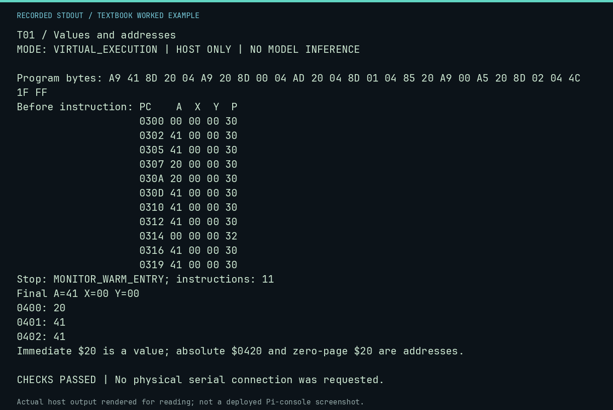

# T01 worked lab: Values and addresses

**Goal:** Distinguish immediate, zero-page and absolute loads.

**Mode:** `VIRTUAL_EXECUTION`. This companion runs on the host; it does not
change the original packet's paper activity or authorize physical Replica work.

## Understand the example

The # marker makes $20 a value. Without it, the CPU reads a location. A load can change A and N/Z without changing memory. The example stores three results so the distinction stays visible. Zero-page scratch here is for the CPU lab, not an experiment-agent privilege.

## Predict before running

Read the source below. Write down the expected printed values and the condition
that would make its checks fail. For a CPU trace, distinguish state before an
instruction from state after it. For a conceptual exercise, explain the rule
behind each classification rather than memorizing the printed label.

## Run it

From the checkout root with your environment active:

```bash
python -m tools.textbook run T01
```

The runner executes this [complete source](../examples/T01.py):

```python
from tools.textbook_support import cpu

source = """
LDA #$41
STA $0420
LDA #$20
STA $0400
LDA $0420
STA $0401
STA $20
LDA #$00
LDA $20
STA $0402
JMP $FF1F
"""
w, r, _ = cpu(source, inspect=(0x400, 0x401, 0x402), trace=True)
assert w.host_read(0x400, 3) == bytes.fromhex("20 41 41")
print("Immediate $20 is a value; absolute $0420 and zero-page $20 are addresses.")
```

## Recorded result

This output was actually executed and checked. The image is a readable render
of that stdout, not a screenshot of the deployed Pi console. A teaching fixture
or a host analogue is not independent historical or physical evidence.

```text
T01 / Values and addresses
MODE: VIRTUAL_EXECUTION | HOST ONLY | NO MODEL INFERENCE

Program bytes: A9 41 8D 20 04 A9 20 8D 00 04 AD 20 04 8D 01 04 85 20 A9 00 A5 20 8D 02 04 4C 1F FF
Before instruction: PC    A  X  Y  P
                    0300 00 00 00 30
                    0302 41 00 00 30
                    0305 41 00 00 30
                    0307 20 00 00 30
                    030A 20 00 00 30
                    030D 41 00 00 30
                    0310 41 00 00 30
                    0312 41 00 00 30
                    0314 00 00 00 32
                    0316 41 00 00 30
                    0319 41 00 00 30
Stop: MONITOR_WARM_ENTRY; instructions: 11
Final A=41 X=00 Y=00
0400: 20
0401: 41
0402: 41
Immediate $20 is a value; absolute $0420 and zero-page $20 are addresses.

CHECKS PASSED | No physical serial connection was requested.
```



[Raw output](../captures/T01.txt) · [Capture manifest](../captures/manifest.json)

## Change one thing

Change LDA #$20 to LDA $20 before the first store. Is that byte initialized yet?

<details>
<summary>Compare your reasoning with the worked answer</summary>

No. This program writes $20 later. In this zero-initialized world the first result becomes zero, but an arbitrary physical machine need not start with zero there.

</details>

## Check your understanding

Explain the result without reading the code aloud. Name one condition that the
example did not test. Keep your prediction, changed input, actual output, and
interpretation together in your lab notebook. Use the linked textbook chapter
and the original source records for the broader context and evidence limits.

[Textbook home](../README.md) · Previous: [F36: Connect a virtual echo program to a fixed-response bridge](F36.md) · Next: [T02: Copy a table with sentinels](T02.md)
