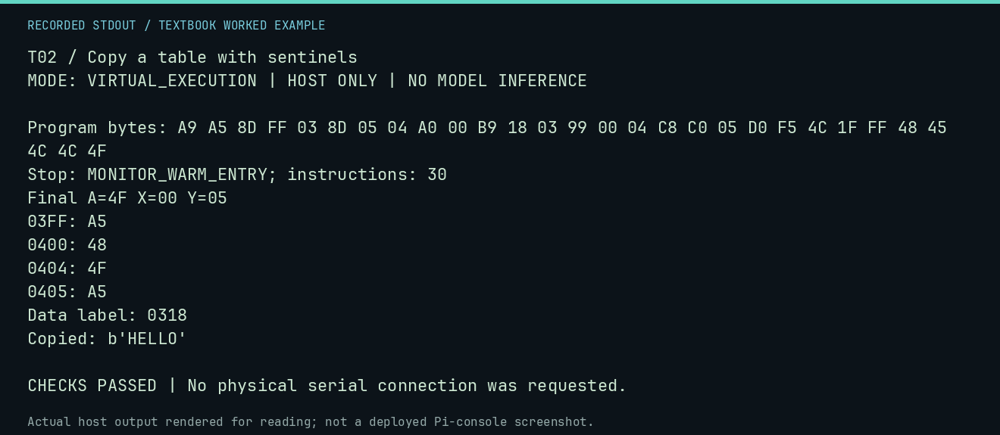

# T02 worked lab: Copy a table with sentinels

**Goal:** Follow an indexed copy from source bytes to a destination range.

**Mode:** `VIRTUAL_EXECUTION`. This companion runs on the host; it does not
change the original packet's paper activity or authorize physical Replica work.

## Understand the example

DATA names the actual address after the final JMP. LDA DATA,Y reads source+Y; STA $0400,Y writes destination+Y. The loop executes for Y=0..4. Sentinels at $03FF and $0405 catch writes immediately outside the five-byte destination. The forward-label regression check ensures the assembler sizes the load correctly.

## Predict before running

Read the source below. Write down the expected printed values and the condition
that would make its checks fail. For a CPU trace, distinguish state before an
instruction from state after it. For a conceptual exercise, explain the rule
behind each classification rather than memorizing the printed label.

## Run it

From the checkout root with your environment active:

```bash
python -m tools.textbook run T02
```

The runner executes this [complete source](../examples/T02.py):

```python
from tools.textbook_support import cpu

source = """
LDA #$A5
STA $03FF
STA $0405
LDY #$00
COPY: LDA DATA,Y
STA $0400,Y
INY
CPY #$05
BNE COPY
JMP $FF1F
DATA: .BYTE $48,$45,$4C,$4C,$4F
"""
w, r, a = cpu(source, inspect=(0x3FF, 0x400, 0x404, 0x405))
print("Data label:", f"{a.symbols['DATA']:04X}")
print("Copied:", repr(w.host_read(0x400, 5)))
assert w.host_read(0x3FF, 7) == b"\xA5HELLO\xA5"
assert r.final_y == 5 and r.stop_reason == "MONITOR_WARM_ENTRY"
```

## Recorded result

This output was actually executed and checked. The image is a readable render
of that stdout, not a screenshot of the deployed Pi console. A teaching fixture
or a host analogue is not independent historical or physical evidence.

```text
T02 / Copy a table with sentinels
MODE: VIRTUAL_EXECUTION | HOST ONLY | NO MODEL INFERENCE

Program bytes: A9 A5 8D FF 03 8D 05 04 A0 00 B9 18 03 99 00 04 C8 C0 05 D0 F5 4C 1F FF 48 45 4C 4C 4F
Stop: MONITOR_WARM_ENTRY; instructions: 30
Final A=4F X=00 Y=05
03FF: A5
0400: 48
0404: 4F
0405: A5
Data label: 0318
Copied: b'HELLO'

CHECKS PASSED | No physical serial connection was requested.
```



[Raw output](../captures/T02.txt) · [Capture manifest](../captures/manifest.json)

## Change one thing

Change CPY #$05 to CPY #$06. Predict the first failing check.

<details>
<summary>Compare your reasoning with the worked answer</summary>

A sixth source byte is read and $0405 is overwritten, so the upper sentinel check fails. A clean Monitor return is insufficient.

</details>

## Check your understanding

Explain the result without reading the code aloud. Name one condition that the
example did not test. Keep your prediction, changed input, actual output, and
interpretation together in your lab notebook. Use the linked textbook chapter
and the original source records for the broader context and evidence limits.

[Textbook home](../README.md) · Previous: [T01: Values and addresses](T01.md) · Next: [T03: Carry and signed overflow](T03.md)
