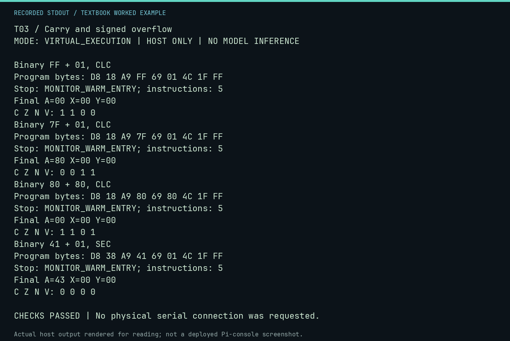

# T03 worked lab: Carry and signed overflow

**Goal:** Read C, Z, N and V as different questions.

**Mode:** `VIRTUAL_EXECUTION`. This companion runs on the host; it does not
change the original packet's paper activity or authorize physical Replica work.

## Understand the example

Binary ADC computes A+operand+incoming carry. C reports an unsigned ninth bit. V reports a signed result outside -128..127. N reflects result bit 7 and Z a zero byte. $7F+1 has V=1 and C=0; $FF+1 has C=1 and V=0. CLD fixes the arithmetic mode before every test.

## Predict before running

Read the source below. Write down the expected printed values and the condition
that would make its checks fail. For a CPU trace, distinguish state before an
instruction from state after it. For a conceptual exercise, explain the rule
behind each classification rather than memorizing the printed label.

## Run it

From the checkout root with your environment active:

```bash
python -m tools.textbook run T03
```

The runner executes this [complete source](../examples/T03.py):

```python
from tools.textbook_support import cpu

for left, right, carry, expected, flags in [
    (0xFF, 1, "CLC", 0, (1, 1, 0, 0)),
    (0x7F, 1, "CLC", 0x80, (0, 0, 1, 1)),
    (0x80, 0x80, "CLC", 0, (1, 1, 0, 1)),
    (0x41, 1, "SEC", 0x43, (0, 0, 0, 0)),
]:
    print(f"Binary {left:02X} + {right:02X}, {carry}")
    _, r, _ = cpu(f"CLD\n{carry}\nLDA #${left:02X}\nADC #${right:02X}\nJMP $FF1F", inspect=())
    actual = tuple(int(bool(r.final_p & mask)) for mask in (1, 2, 128, 64))
    print("C Z N V:", *actual)
    assert r.final_a == expected and actual == flags
```

## Recorded result

This output was actually executed and checked. The image is a readable render
of that stdout, not a screenshot of the deployed Pi console. A teaching fixture
or a host analogue is not independent historical or physical evidence.

```text
T03 / Carry and signed overflow
MODE: VIRTUAL_EXECUTION | HOST ONLY | NO MODEL INFERENCE

Binary FF + 01, CLC
Program bytes: D8 18 A9 FF 69 01 4C 1F FF
Stop: MONITOR_WARM_ENTRY; instructions: 5
Final A=00 X=00 Y=00
C Z N V: 1 1 0 0
Binary 7F + 01, CLC
Program bytes: D8 18 A9 7F 69 01 4C 1F FF
Stop: MONITOR_WARM_ENTRY; instructions: 5
Final A=80 X=00 Y=00
C Z N V: 0 0 1 1
Binary 80 + 80, CLC
Program bytes: D8 18 A9 80 69 80 4C 1F FF
Stop: MONITOR_WARM_ENTRY; instructions: 5
Final A=00 X=00 Y=00
C Z N V: 1 1 0 1
Binary 41 + 01, SEC
Program bytes: D8 38 A9 41 69 01 4C 1F FF
Stop: MONITOR_WARM_ENTRY; instructions: 5
Final A=43 X=00 Y=00
C Z N V: 0 0 0 0

CHECKS PASSED | No physical serial connection was requested.
```



[Raw output](../captures/T03.txt) · [Capture manifest](../captures/manifest.json)

## Change one thing

Predict $40+$40 with CLC: result, C and V.

<details>
<summary>Compare your reasoning with the worked answer</summary>

Result $80, C=0, V=1. Unsigned 64+64 fits a byte; signed +128 does not fit signed eight-bit range.

</details>

## Check your understanding

Explain the result without reading the code aloud. Name one condition that the
example did not test. Keep your prediction, changed input, actual output, and
interpretation together in your lab notebook. Use the linked textbook chapter
and the original source records for the broader context and evidence limits.

[Textbook home](../README.md) · Previous: [T02: Copy a table with sentinels](T02.md) · Next: [T04: Carry a result across two bytes](T04.md)
