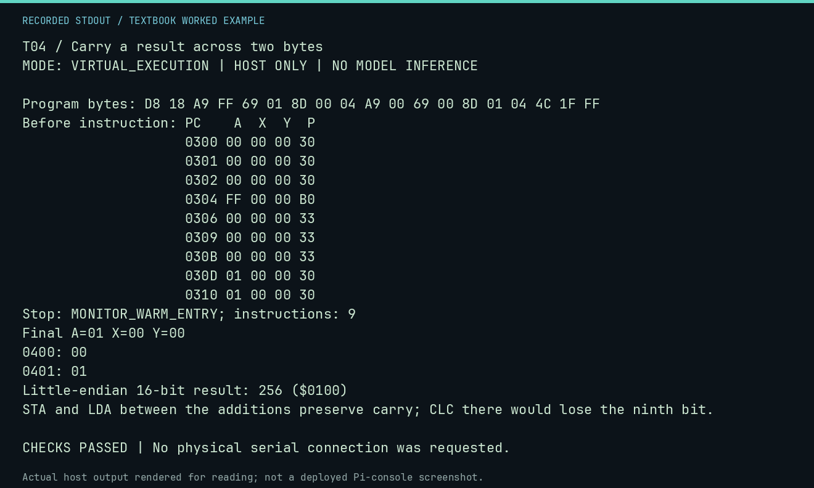

# T04 worked lab: Carry a result across two bytes

**Goal:** Implement a 16-bit little-endian addition.

**Mode:** `VIRTUAL_EXECUTION`. This companion runs on the host; it does not
change the original packet's paper activity or authorize physical Replica work.

## Understand the example

Add the low bytes with CLC once. Store the low result, load the high operand, and ADC the high operand while preserving carry. LDA and STA preserve C, even though LDA changes N/Z. The memory pair $00,$01 is $0100, or 256.

## Predict before running

Read the source below. Write down the expected printed values and the condition
that would make its checks fail. For a CPU trace, distinguish state before an
instruction from state after it. For a conceptual exercise, explain the rule
behind each classification rather than memorizing the printed label.

## Run it

From the checkout root with your environment active:

```bash
python -m tools.textbook run T04
```

The runner executes this [complete source](../examples/T04.py):

```python
from tools.textbook_support import cpu

w, r, _ = cpu("""
CLD
CLC
LDA #$FF
ADC #$01
STA $0400
LDA #$00
ADC #$00
STA $0401
JMP $FF1F
""", inspect=(0x400, 0x401), trace=True)
value = int.from_bytes(w.host_read(0x400, 2), "little")
print("Little-endian 16-bit result:", value, f"(${value:04X})")
assert value == 256
print("STA and LDA between the additions preserve carry; CLC there would lose the ninth bit.")
```

## Recorded result

This output was actually executed and checked. The image is a readable render
of that stdout, not a screenshot of the deployed Pi console. A teaching fixture
or a host analogue is not independent historical or physical evidence.

```text
T04 / Carry a result across two bytes
MODE: VIRTUAL_EXECUTION | HOST ONLY | NO MODEL INFERENCE

Program bytes: D8 18 A9 FF 69 01 8D 00 04 A9 00 69 00 8D 01 04 4C 1F FF
Before instruction: PC    A  X  Y  P
                    0300 00 00 00 30
                    0301 00 00 00 30
                    0302 00 00 00 30
                    0304 FF 00 00 B0
                    0306 00 00 00 33
                    0309 00 00 00 33
                    030B 00 00 00 33
                    030D 01 00 00 30
                    0310 01 00 00 30
Stop: MONITOR_WARM_ENTRY; instructions: 9
Final A=01 X=00 Y=00
0400: 00
0401: 01
Little-endian 16-bit result: 256 ($0100)
STA and LDA between the additions preserve carry; CLC there would lose the ninth bit.

CHECKS PASSED | No physical serial connection was requested.
```



[Raw output](../captures/T04.txt) · [Capture manifest](../captures/manifest.json)

## Change one thing

Insert CLC immediately before the second ADC. What is lost?

<details>
<summary>Compare your reasoning with the worked answer</summary>

The carry from $FF+1 disappears; the high result becomes $00, incorrectly giving $0000 instead of $0100.

</details>

## Check your understanding

Explain the result without reading the code aloud. Name one condition that the
example did not test. Keep your prediction, changed input, actual output, and
interpretation together in your lab notebook. Use the linked textbook chapter
and the original source records for the broader context and evidence limits.

[Textbook home](../README.md) · Previous: [T03: Carry and signed overflow](T03.md) · Next: [T05: Subtract and compare deliberately](T05.md)
