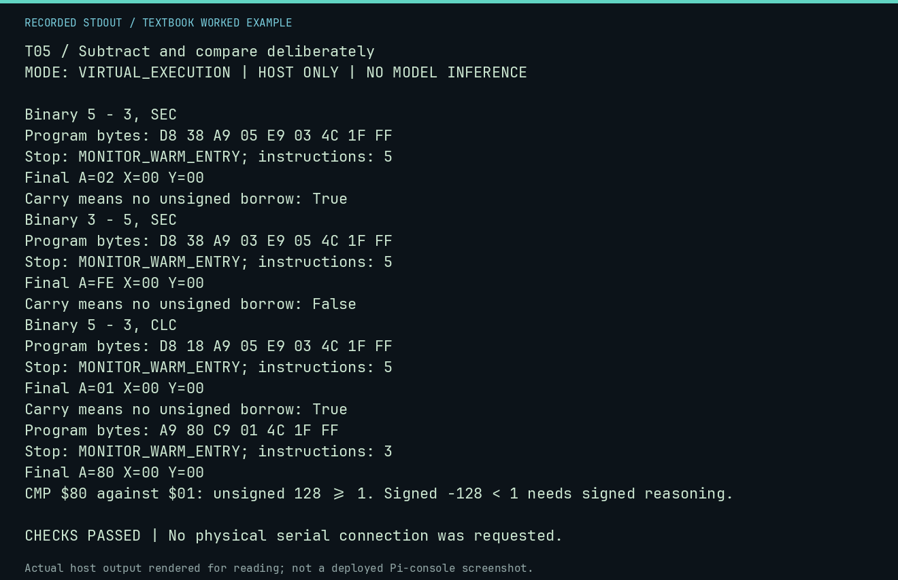

# T05 worked lab: Subtract and compare deliberately

**Goal:** Use carry as no borrow and separate signed comparison.

**Mode:** `VIRTUAL_EXECUTION`. This companion runs on the host; it does not
change the original packet's paper activity or authorize physical Replica work.

## Understand the example

SBC computes A-operand-(1-C), so ordinary subtraction begins with SEC. CMP leaves A intact and sets flags as a comparison; carry set means unsigned A>=operand. N alone is not a general signed-less-than test when signed overflow is possible.

## Predict before running

Read the source below. Write down the expected printed values and the condition
that would make its checks fail. For a CPU trace, distinguish state before an
instruction from state after it. For a conceptual exercise, explain the rule
behind each classification rather than memorizing the printed label.

## Run it

From the checkout root with your environment active:

```bash
python -m tools.textbook run T05
```

The runner executes this [complete source](../examples/T05.py):

```python
from tools.textbook_support import cpu

for left, right, incoming, expected, no_borrow in [(5, 3, "SEC", 2, True), (3, 5, "SEC", 254, False), (5, 3, "CLC", 1, True)]:
    print(f"Binary {left} - {right}, {incoming}")
    _, r, _ = cpu(f"CLD\n{incoming}\nLDA #${left:02X}\nSBC #${right:02X}\nJMP $FF1F", inspect=())
    print("Carry means no unsigned borrow:", bool(r.final_p & 1))
    assert r.final_a == expected and bool(r.final_p & 1) == no_borrow
_, r, _ = cpu("LDA #$80\nCMP #$01\nJMP $FF1F", inspect=())
assert r.final_a == 0x80 and r.final_p & 1 and not r.final_p & 128
print("CMP $80 against $01: unsigned 128 >= 1. Signed -128 < 1 needs signed reasoning.")
```

## Recorded result

This output was actually executed and checked. The image is a readable render
of that stdout, not a screenshot of the deployed Pi console. A teaching fixture
or a host analogue is not independent historical or physical evidence.

```text
T05 / Subtract and compare deliberately
MODE: VIRTUAL_EXECUTION | HOST ONLY | NO MODEL INFERENCE

Binary 5 - 3, SEC
Program bytes: D8 38 A9 05 E9 03 4C 1F FF
Stop: MONITOR_WARM_ENTRY; instructions: 5
Final A=02 X=00 Y=00
Carry means no unsigned borrow: True
Binary 3 - 5, SEC
Program bytes: D8 38 A9 03 E9 05 4C 1F FF
Stop: MONITOR_WARM_ENTRY; instructions: 5
Final A=FE X=00 Y=00
Carry means no unsigned borrow: False
Binary 5 - 3, CLC
Program bytes: D8 18 A9 05 E9 03 4C 1F FF
Stop: MONITOR_WARM_ENTRY; instructions: 5
Final A=01 X=00 Y=00
Carry means no unsigned borrow: True
Program bytes: A9 80 C9 01 4C 1F FF
Stop: MONITOR_WARM_ENTRY; instructions: 3
Final A=80 X=00 Y=00
CMP $80 against $01: unsigned 128 >= 1. Signed -128 < 1 needs signed reasoning.

CHECKS PASSED | No physical serial connection was requested.
```



[Raw output](../captures/T05.txt) · [Capture manifest](../captures/manifest.json)

## Change one thing

Why does starting 5-3 with CLC give 1?

<details>
<summary>Compare your reasoning with the worked answer</summary>

CLC supplies an incoming borrow: 5-3-(1-0)=1. With SEC it is 5-3-(1-1)=2.

</details>

## Check your understanding

Explain the result without reading the code aloud. Name one condition that the
example did not test. Keep your prediction, changed input, actual output, and
interpretation together in your lab notebook. Use the linked textbook chapter
and the original source records for the broader context and evidence limits.

[Textbook home](../README.md) · Previous: [T04: Carry a result across two bytes](T04.md) · Next: [T06: Masks, shifts and rotates](T06.md)
