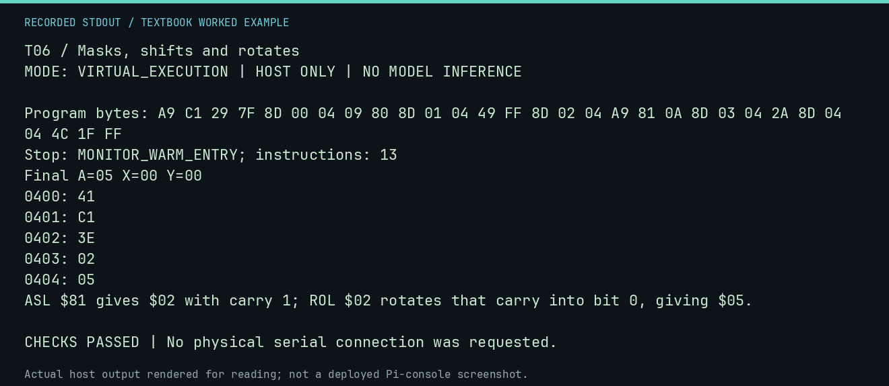

# T06 worked lab: Masks, shifts and rotates

**Goal:** Track selected bits and carry through a rotate.

**Mode:** `VIRTUAL_EXECUTION`. This companion runs on the host; it does not
change the original packet's paper activity or authorize physical Replica work.

## Understand the example

AND clears selected bits, ORA sets selected bits, and EOR flips selected bits. ASL shifts bit 7 into C and shifts zero into bit 0. ROL includes carry as a ninth bit in the operation; the following STA does not destroy that carry.

## Predict before running

Read the source below. Write down the expected printed values and the condition
that would make its checks fail. For a CPU trace, distinguish state before an
instruction from state after it. For a conceptual exercise, explain the rule
behind each classification rather than memorizing the printed label.

## Run it

From the checkout root with your environment active:

```bash
python -m tools.textbook run T06
```

The runner executes this [complete source](../examples/T06.py):

```python
from tools.textbook_support import cpu

w, _, _ = cpu("""
LDA #$C1
AND #$7F
STA $0400
ORA #$80
STA $0401
EOR #$FF
STA $0402
LDA #$81
ASL A
STA $0403
ROL A
STA $0404
JMP $FF1F
""", inspect=tuple(range(0x400, 0x405)))
assert w.host_read(0x400, 5) == bytes.fromhex("41 C1 3E 02 05")
print("ASL $81 gives $02 with carry 1; ROL $02 rotates that carry into bit 0, giving $05.")
```

## Recorded result

This output was actually executed and checked. The image is a readable render
of that stdout, not a screenshot of the deployed Pi console. A teaching fixture
or a host analogue is not independent historical or physical evidence.

```text
T06 / Masks, shifts and rotates
MODE: VIRTUAL_EXECUTION | HOST ONLY | NO MODEL INFERENCE

Program bytes: A9 C1 29 7F 8D 00 04 09 80 8D 01 04 49 FF 8D 02 04 A9 81 0A 8D 03 04 2A 8D 04 04 4C 1F FF
Stop: MONITOR_WARM_ENTRY; instructions: 13
Final A=05 X=00 Y=00
0400: 41
0401: C1
0402: 3E
0403: 02
0404: 05
ASL $81 gives $02 with carry 1; ROL $02 rotates that carry into bit 0, giving $05.

CHECKS PASSED | No physical serial connection was requested.
```



[Raw output](../captures/T06.txt) · [Capture manifest](../captures/manifest.json)

## Change one thing

Insert CLC before ROL A. Predict the last stored byte.

<details>
<summary>Compare your reasoning with the worked answer</summary>

The last byte becomes $04 instead of $05 because the incoming bit is zero.

</details>

## Check your understanding

Explain the result without reading the code aloud. Name one condition that the
example did not test. Keep your prediction, changed input, actual output, and
interpretation together in your lab notebook. Use the linked textbook chapter
and the original source records for the broader context and evidence limits.

[Textbook home](../README.md) · Previous: [T05: Subtract and compare deliberately](T05.md) · Next: [T07: Calls and the page-one stack](T07.md)
