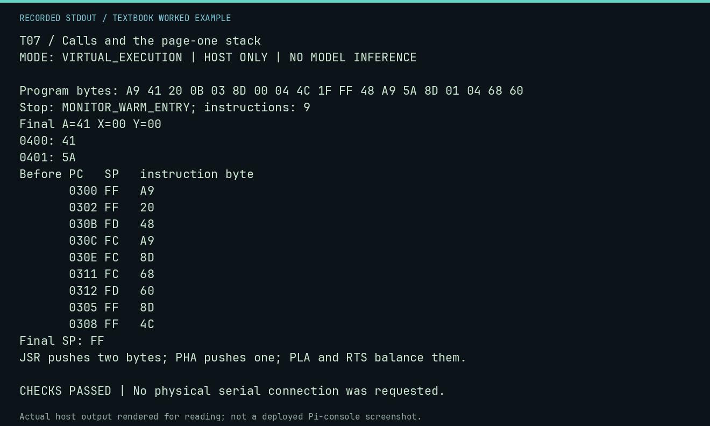

# T07 worked lab: Calls and the page-one stack

**Goal:** Balance JSR/RTS and PHA/PLA while preserving A.

**Mode:** `VIRTUAL_EXECUTION`. This companion runs on the host; it does not
change the original packet's paper activity or authorize physical Replica work.

## Understand the example

The caller loads A with $41 and calls SUB. JSR stores two return bytes; the stack pointer goes from $FF to $FD. PHA saves A and moves SP to $FC. PLA restores A and RTS consumes the call frame. The subroutine writes Z at $0401 but preserves A for the caller to store A at $0400. These traces show Py65 state, not electrical stack cycles.

## Predict before running

Read the source below. Write down the expected printed values and the condition
that would make its checks fail. For a CPU trace, distinguish state before an
instruction from state after it. For a conceptual exercise, explain the rule
behind each classification rather than memorizing the printed label.

## Run it

From the checkout root with your environment active:

```bash
python -m tools.textbook run T07
```

The runner executes this [complete source](../examples/T07.py):

```python
from tools.textbook_support import cpu

w, r, a = cpu("""
LDA #$41
JSR SUB
STA $0400
JMP $FF1F
SUB: PHA
LDA #$5A
STA $0401
PLA
RTS
""", inspect=(0x400, 0x401))
print("Before PC   SP   instruction byte")
for row in r.trace:
    print(f"       {row.pc:04X} {row.sp:02X}   {row.opcode:02X}")
print("Final SP:", f"{r.final_sp:02X}")
assert w.host_read(0x400, 2) == b"AZ" and r.final_a == 0x41
assert r.final_sp == r.trace[0].sp == 0xFF
assert [row.sp for row in r.trace if row.pc == a.symbols["SUB"]] == [0xFD]
print("JSR pushes two bytes; PHA pushes one; PLA and RTS balance them.")
```

## Recorded result

This output was actually executed and checked. The image is a readable render
of that stdout, not a screenshot of the deployed Pi console. A teaching fixture
or a host analogue is not independent historical or physical evidence.

```text
T07 / Calls and the page-one stack
MODE: VIRTUAL_EXECUTION | HOST ONLY | NO MODEL INFERENCE

Program bytes: A9 41 20 0B 03 8D 00 04 4C 1F FF 48 A9 5A 8D 01 04 68 60
Stop: MONITOR_WARM_ENTRY; instructions: 9
Final A=41 X=00 Y=00
0400: 41
0401: 5A
Before PC   SP   instruction byte
       0300 FF   A9
       0302 FF   20
       030B FD   48
       030C FC   A9
       030E FC   8D
       0311 FC   68
       0312 FD   60
       0305 FF   8D
       0308 FF   4C
Final SP: FF
JSR pushes two bytes; PHA pushes one; PLA and RTS balance them.

CHECKS PASSED | No physical serial connection was requested.
```



[Raw output](../captures/T07.txt) · [Capture manifest](../captures/manifest.json)

## Change one thing

Remove PLA. Can RTS still find its matching return frame?

<details>
<summary>Compare your reasoning with the worked answer</summary>

No. The saved accumulator is above the return bytes, so RTS pulls the wrong pair. The final memory/exit/SP checks expose the unbalanced stack.

</details>

## Check your understanding

Explain the result without reading the code aloud. Name one condition that the
example did not test. Keep your prediction, changed input, actual output, and
interpretation together in your lab notebook. Use the linked textbook chapter
and the original source records for the broader context and evidence limits.

[Textbook home](../README.md) · Previous: [T06: Masks, shifts and rotates](T06.md) · Next: [T08: Two kinds of indexed pointers](T08.md)
