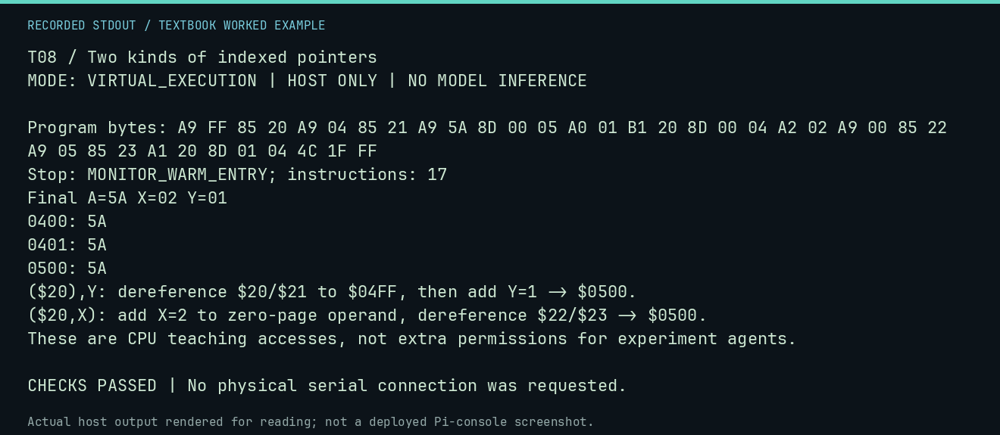

# T08 worked lab: Two kinds of indexed pointers

**Goal:** Separate indexing a pointer from indexing its destination.

**Mode:** `VIRTUAL_EXECUTION`. This companion runs on the host; it does not
change the original packet's paper activity or authorize physical Replica work.

## Understand the example

A zero-page pointer occupies a low byte followed by a high byte. ($20),Y reads that pointer then adds Y; ($20,X) adds X within zero page before reading a pointer. The first example deliberately crosses $04FF to $0500. These are NMOS CPU forms, and their allowed use still depends on the surrounding experiment policy.

## Predict before running

Read the source below. Write down the expected printed values and the condition
that would make its checks fail. For a CPU trace, distinguish state before an
instruction from state after it. For a conceptual exercise, explain the rule
behind each classification rather than memorizing the printed label.

## Run it

From the checkout root with your environment active:

```bash
python -m tools.textbook run T08
```

The runner executes this [complete source](../examples/T08.py):

```python
from tools.textbook_support import cpu

w, _, _ = cpu("""
LDA #$FF
STA $20
LDA #$04
STA $21
LDA #$5A
STA $0500
LDY #$01
LDA ($20),Y
STA $0400
LDX #$02
LDA #$00
STA $22
LDA #$05
STA $23
LDA ($20,X)
STA $0401
JMP $FF1F
""", inspect=(0x400, 0x401, 0x500))
assert w.host_read(0x400, 2) == b"ZZ"
print("($20),Y: dereference $20/$21 to $04FF, then add Y=1 -> $0500.")
print("($20,X): add X=2 to zero-page operand, dereference $22/$23 -> $0500.")
print("These are CPU teaching accesses, not extra permissions for experiment agents.")
```

## Recorded result

This output was actually executed and checked. The image is a readable render
of that stdout, not a screenshot of the deployed Pi console. A teaching fixture
or a host analogue is not independent historical or physical evidence.

```text
T08 / Two kinds of indexed pointers
MODE: VIRTUAL_EXECUTION | HOST ONLY | NO MODEL INFERENCE

Program bytes: A9 FF 85 20 A9 04 85 21 A9 5A 8D 00 05 A0 01 B1 20 8D 00 04 A2 02 A9 00 85 22 A9 05 85 23 A1 20 8D 01 04 4C 1F FF
Stop: MONITOR_WARM_ENTRY; instructions: 17
Final A=5A X=02 Y=01
0400: 5A
0401: 5A
0500: 5A
($20),Y: dereference $20/$21 to $04FF, then add Y=1 -> $0500.
($20,X): add X=2 to zero-page operand, dereference $22/$23 -> $0500.
These are CPU teaching accesses, not extra permissions for experiment agents.

CHECKS PASSED | No physical serial connection was requested.
```



[Raw output](../captures/T08.txt) · [Capture manifest](../captures/manifest.json)

## Change one thing

Set Y=0 in the first indirect load. Does it still read $0500?

<details>
<summary>Compare your reasoning with the worked answer</summary>

No. The pointer is $04FF, so without the increment it reads $04FF, which this fixture leaves zero.

</details>

## Check your understanding

Explain the result without reading the code aloud. Name one condition that the
example did not test. Keep your prediction, changed input, actual output, and
interpretation together in your lab notebook. Use the linked textbook chapter
and the original source records for the broader context and evidence limits.

[Textbook home](../README.md) · Previous: [T07: Calls and the page-one stack](T07.md) · Next: [T09: Labels and branch arithmetic](T09.md)
