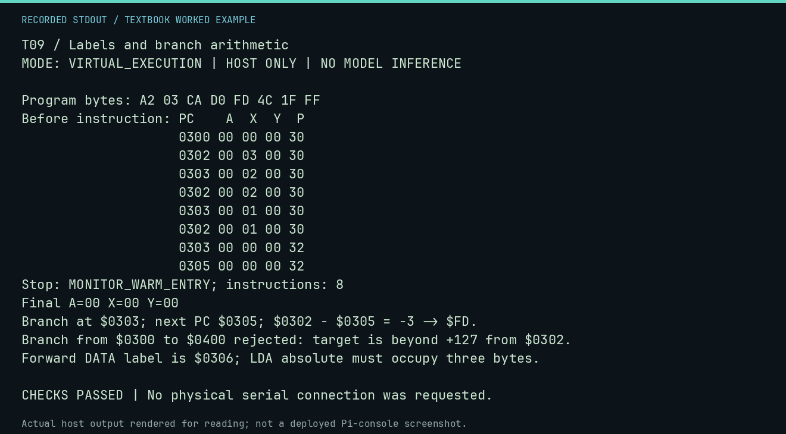

# T09 worked lab: Labels and branch arithmetic

**Goal:** Calculate a relative branch and reject an unreachable target.

**Mode:** `VIRTUAL_EXECUTION`. This companion runs on the host; it does not
change the original packet's paper activity or authorize physical Replica work.

## Understand the example

The displacement is target-(branch address+2), encoded as a signed byte. -3 becomes $FD. Branches reach -128..127 from the following PC. The lesson assembler now rejects a far target instead of silently wrapping it and resolves forward data labels after instruction sizes stabilize.

## Predict before running

Read the source below. Write down the expected printed values and the condition
that would make its checks fail. For a CPU trace, distinguish state before an
instruction from state after it. For a conceptual exercise, explain the rule
behind each classification rather than memorizing the printed label.

## Run it

From the checkout root with your environment active:

```bash
python -m tools.textbook run T09
```

The runner executes this [complete source](../examples/T09.py):

```python
from neural1.assembler import LessonAssembler
from tools.textbook_support import cpu

_, r, a = cpu("LDX #$03\nLOOP: DEX\nBNE LOOP\nJMP $FF1F", inspect=(), trace=True)
assert a.payload[3:5] == bytes.fromhex("D0 FD")
print("Branch at $0303; next PC $0305; $0302 - $0305 = -3 -> $FD.")
assert r.final_x == 0
bad = LessonAssembler().assemble("BNE $0400", origin=0x300)
assert bad.diagnostics
print("Branch from $0300 to $0400 rejected: target is beyond +127 from $0302.")
forward = LessonAssembler().assemble("LDA DATA\nJMP $FF1F\nDATA: .BYTE $41", origin=0x300)
assert forward.symbols["DATA"] == 0x306 and forward.payload[:3] == bytes.fromhex("AD 06 03")
print("Forward DATA label is $0306; LDA absolute must occupy three bytes.")
```

## Recorded result

This output was actually executed and checked. The image is a readable render
of that stdout, not a screenshot of the deployed Pi console. A teaching fixture
or a host analogue is not independent historical or physical evidence.

```text
T09 / Labels and branch arithmetic
MODE: VIRTUAL_EXECUTION | HOST ONLY | NO MODEL INFERENCE

Program bytes: A2 03 CA D0 FD 4C 1F FF
Before instruction: PC    A  X  Y  P
                    0300 00 00 00 30
                    0302 00 03 00 30
                    0303 00 02 00 30
                    0302 00 02 00 30
                    0303 00 01 00 30
                    0302 00 01 00 30
                    0303 00 00 00 32
                    0305 00 00 00 32
Stop: MONITOR_WARM_ENTRY; instructions: 8
Final A=00 X=00 Y=00
Branch at $0303; next PC $0305; $0302 - $0305 = -3 -> $FD.
Branch from $0300 to $0400 rejected: target is beyond +127 from $0302.
Forward DATA label is $0306; LDA absolute must occupy three bytes.

CHECKS PASSED | No physical serial connection was requested.
```



[Raw output](../captures/T09.txt) · [Capture manifest](../captures/manifest.json)

## Change one thing

A branch begins at $0300 and targets $0381. Is it in range?

<details>
<summary>Compare your reasoning with the worked answer</summary>

Yes. $0381-$0302=$7F, or +127. $0382 would be out of range.

</details>

## Check your understanding

Explain the result without reading the code aloud. Name one condition that the
example did not test. Keep your prediction, changed input, actual output, and
interpretation together in your lab notebook. Use the linked textbook chapter
and the original source records for the broader context and evidence limits.

[Textbook home](../README.md) · Previous: [T08: Two kinds of indexed pointers](T08.md) · Next: [T10: Review the original A06 program](T10.md)
